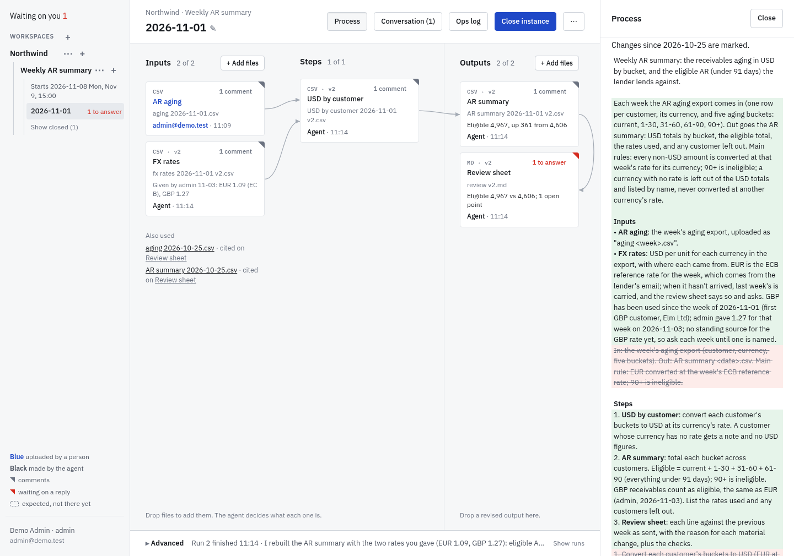
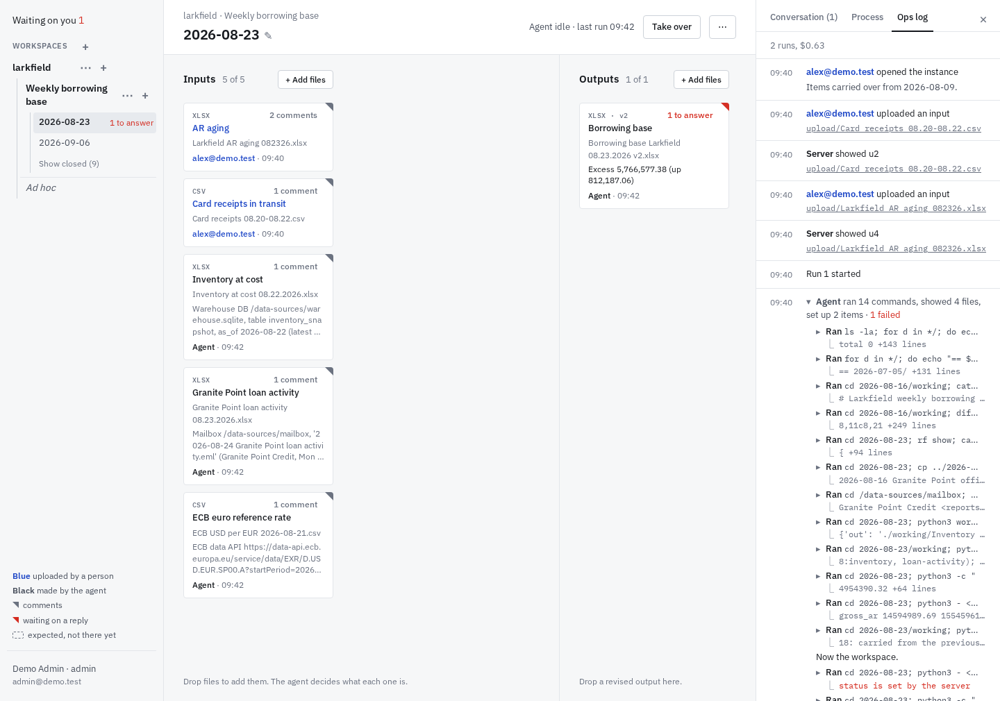

# rollforward

Recurring tasks, files in and files out. People drop this period's input files into an instance of a series. An agent learns the transform from the closed instances, produces the output files, and talks in threads pinned to the cells, files and instances they're about: it says what people should know and asks what they should decide. The screen shows the work as a graph, from the inputs through the agent's steps to the outputs. People reply in a thread, drop in a corrected file when one was wrong, and close the instance when it's done. There is no prompt box on the main screen.

- **The agent** is [Pi](https://www.npmjs.com/package/@earendil-works/pi-coding-agent), run over RPC with read, bash, edit and write tools, in its series' folder, in a sandbox of its own. It copies and adapts the previous instance's scripts, so each instance's `working/` is a complete record of how its outputs were made.
- **Inputs** are uploads, or sources a person points the agent to, such as a database, a mailbox folder or a web API. The agent keeps a frozen copy of what it read, and the tile shows where it came from.
- **Skills** reach systems outside the series, and every run loads every live one. They are each deployment's own, pushed by publishers with `rf skill push`; none ship with this repo.
- **Workspaces hold series,** such as one client's, and its owners and members see them.
- **People sign in with Microsoft,** with one button, and **logins are each person's own:** a run reaches Microsoft 365 and websites only through its runner's logins, and only those ticked for its instance.
- **Wakes:** an agent sets when its instance, or its series' next period, runs again; nothing is scheduled.
- **AGENTS.md:** every run loads the company's and its workspace's. It finds the series it can read as folders under `/work`: its own workspace's, and those of any workspace that has everyone its own has, so nothing it reads reaches someone who couldn't see it already.
- **rf** is people's command line, with a personal token: what the page does, plus `rf pull`, which copies what you can see as rsync does, for your own desktop agent, and `rf help`, its guide. For watching over runs, `rf status` shows what goes on and what's stuck, `rf runs` the history of runs and `rf costs` their totals. Admin is rf, not the page: `rf people` prints everyone, or a workspace's people, as lines to edit and set back with `--set`, which refuses a change that would hide an open instance from the person who runs it, unless `--force`, and `rf brand` gives the deployment its logo and text. Install it with `npm i -g @rfany/rf` ([cli/](cli/)).
- **Everything is files on disk,** with no database.

| A tile's card and its threads | Preview, compared with the file it replaced |
|---|---|
|  |  |
| **Conversation: what waits on people, the report and the threads** | **Process, marked against the previous instance** |
|  |  |
| **Ops log: a run's work in one row, open to each tool call** | **Phone** |
|  |  |

## Try it

    cp .env.example .env          # set OPENROUTER_API_KEY
    docker compose up --build     # then open http://127.0.0.1:8780

The image starts empty. Until an app is registered (see Access), Sign in with Microsoft offers two demo accounts: take the admin.

- **A new series:** make a workspace (+ by Workspaces), a series in it, and an instance for a past period. Drop its inputs on the left and what was actually sent on the right. The agent rebuilds each output from the inputs and says what it couldn't derive; close the instance once it's right. Import a few periods this way, oldest first.
- **The next period:** a new instance starts from the latest closed one, its tiles dashed until their files come. Drop this period's files: the agent builds the outputs, asks what a reviewer might decide differently, and ends each run with a report.
- **A one-off task:** the workspace's + starts one at once, Untitled, on its conversation: write what you need and drop files there, and the first comment starts the run and names the task. If it turns out to recur, make it a series as you close it, or later with Start another based on this.

For scale, a weekly borrowing base's runs cost about $0.20–0.60 each with Claude Opus 5.5 through OpenRouter.

## Concepts

- **People** sign in with a Microsoft account. Each is a **user**, a **publisher**, who also pushes skills, which every run in every workspace loads, so a publisher is trusted with every runner's ticked logins, or an **admin**.
- **Workspace:** a folder of series, usually one entity's work, such as its bank rec, inventory rec and borrowing base. It is the only unit of sharing: its **members** see and work in every series in it, and its **owners** also manage who is in it, each a person by email or an Entra group by id; whoever adds a group may label it, such as Finance HK. An area that needs hiding, such as payroll, is a workspace of its own with fewer people. A workspace with no one in it is the admins'.
- **Series:** a recurring transform, such as "Weekly borrowing base": each instance's input files become its output files. What an instance should contain comes from earlier instances, not from a declaration. A **task** is a one-off: a series marked single, holding one instance and named by its label, Untitled until its first prompt or a rename names it, with no settings. Made a series, as it closes or with **Start another based on this**, which also starts a second instance rolling forward from it, it keeps its id, files and log.
- **Instance:** one pass through a series, under a label people choose, such as "2026-08-24" or "Larkfield refinancing"; instances sort by label. Up to three of a series are open at once. An instance ends **closed**, its runner's sign-off, or **abandoned**.
- **Example:** a closed instance. Its inputs and outputs are an example pair, from which the agent learns the transform, writing it down as scripts and `process.md` in `working/`.
- **Item:** one tile on an instance's screen, with a stable id, a name and a kind: an input, a step (an intermediate result a reviewer would check, such as "Eligible AR", in a file the agent writes) or an output. It shows a file, names the items it's made from (`from`), and may carry a `headline`, an output's main result, or a `source`, where a fetched input came from. Replacing a file means pointing the item at a new one.
- **Graph:** the items, joined by what each is made from: a picture for people, which nothing runs.
- **Run:** one stretch of agent work on an instance, started by an upload, a comment or a wake.
- **Thread:** people and the agent talking about one point, on a cell, an item or the instance (see Talking).
- **Runner:** whoever made the instance, copied it or last took it over; for an instance a wake started, whoever shares the series. Only the runner's comments, uploads, wakes and closings start runs, and its own run's wakes, though it was renamed since, unless the runner shares the series. What other people add is a note for the runner, shared or not: the agent progresses its work with what it brings, and leaves what it asks beyond that until the runner takes it up. A reply from whom the agent's ask named is no note. Runs use the runner's logins, the ones they ticked, which they may tick anew: above the comment box until the first run, and with Logins it may use in the instance's ⋯ menu; only the runner closes or abandons. A chip by the instance's title says whose it is, Yours or their name, and on hover or a click since when, how they came to run it, and the logins they ticked, by name; in the sidebar, an instance or task someone else runs carries their initials.
- **Login:** a person's own sign-in to a system, Microsoft 365 or a website, offering runs what it reaches: mailboxes, files, a site. A run uses only its runner's logins, only those ticked for its instance, and none once the runner is disabled or out of the instance's workspace, until someone takes it over.
- **Skill:** what the agent knows how to fetch or do, and how, whole in a folder, such as the day's AR aging from OneDrive. Every run loads every live skill, so the company's skills are few and chosen with care. Nothing writes to a system outside rollforward: a write the work needs, such as vouchers for the ERP, is an output people take onward.
- **Reach:** a workspace's agents read its other series, and those of any workspace that has everyone it has, by the same email or group, so reading never widens who sees what: a payroll workspace's agent reads the entity's main workspace, never the reverse. They never write there.
- **AGENTS.md:** the company's, the admins', and each workspace's, its owners': conventions, and changes that cut across series, such as a renamed entity, which each series adapts to at its next run.
- **Archive:** a workspace or a series no longer in use leaves the sidebar, but for "Show archived", until it's restored; nothing in it changes.

## The page

- **The sidebar** is a tree of workspaces, in bold, series, in blue, and instances, folded as a file browser's: selecting a row opens it and the rows above it, and leaves the others as they were; from then on its chevron alone folds or opens it, selected or not; an open series lists its open instances, then "Show closed", and a workspace's tasks come last, under Ungrouped, which is no series. Rows come newest activity first, as in a chat: a workspace by the newest activity anywhere in it, and a series or a task by its newest instance's, an instance's activity being its latest log entry, or now while it runs. A series' instances keep their labels' order. Each row shows how long ago its last activity was, as now, 5m, 3h, 2d or 7w, or a spinner while a run goes; a workspace's or series' gives way to its ⚙ and + on hover. A row keeps to one line, a long name cut short and whole on hover; an instance's asks waiting show as a red count, and a series' open instances as a count while it's folded. **Mine | All** keeps to the workspaces you own or worked in, by running, commenting or uploading, and the one you're in. A row's ⚙ opens its settings, where it is renamed and archived, and its + starts a task in a workspace or an instance in a series; both show on hover, and a task has neither. **New to you,** as in a chat: an instance where someone else or the agent did something since you last viewed it, a run ending, a report, a comment, an upload, a takeover or a close, is in bold with a blue dot, and so is a folded workspace or series with one inside; a red dot, for an ask waiting, comes first. What you've seen is the server's, kept per person from their first look, so it follows them across browsers; viewing an instance sees it. **Waiting on you**, at the top when anything does, lists the asks and notes for you, requests to start a series, and your expired logins. The account stays at the foot; on hover it shows Sign out and ⚙, which opens one dialog with tabs, Logins, Tokens and, for admins, People. The colours' key is a chip on the canvas, shown on hover or with `?`, which also lists the keys: with no field focused, `j` `k` move through the sidebar's rows, `h` `l` fold and open them, Enter goes, `1` `2` `3` pick the panel's tab and `c` its comment box; Ctrl+Enter, Cmd+Enter on a Mac, sends from a comment or reply box, and Esc leaves a field.
- **The brand,** the deployment's logo and text, tops the sidebar, and is the page's title and icon. Admins set it with `rf brand`, and the page shows it from its next load; unset, there is none.
- **An instance** is its graph: inputs first, then the steps, column by column, with lines from each tile to what it's made from, and the outputs in a column of their own that stays in view. A tile shows its item's name, file and version, and who made it, by colour: blue for a person, black for the agent. Dashed tiles have no file yet. A corner marks a tile with threads, gray, or red while an ask waits on a reply. A click opens the tile's card: its threads, Preview, Download, Upload and Comment. Under the inputs, "Also used" lists the files the agent's comments cite and no tile shows.
- **Drops are hints.** Outputs and the rest are the two drop zones. The server adds each dropped file as an item at once, even mid-run: an output if it was dropped on Outputs, else an input. The agent decides what it is, such as a replacement for an input's file.
- **Preview** shows a spreadsheet with its threads' cells marked; a click on a cell comments on it or opens its thread. "Compare with previous" marks the cells that changed since the file it replaced.
- **Sources and destinations:** an input says where it came from, uploaded by whom and when, or the agent's `source`, the system or earlier instance it fetched it from; an output may say where it goes, its `destination`, free text the agent writes as the series' instructions name it, such as a mailbox and its recipients or a SharePoint folder, and stays here without one. Each delivery is a `delivered` entry, with where it went and its receipt, which the agent records with `rf delivered ITEM --to WHERE --receipt WHAT`, such as a message's Message-ID or a website's document number; the run's `call` entries, or its browser's requests, bear it out. The output's tile shows its destination and last delivery, and its card every delivery.
- **The side panel,** beside the instance where there's room for both, has three tabs: Conversation, Process and the Ops log. × closes it, and the bar's Conversation button, with the count waiting on people, opens it again; on a phone it covers the page. Its inner edge and the sidebar's drag to widen or narrow them, within bounds, and the browser keeps the widths; a double-click on an edge resets it.
- **Conversation:** the threads waiting on people first, then the agent's latest report, then the other threads, and a box to comment on the instance.
- **Process:** the instance's `working/process.md`, redlined against the instance it was made from, so a reviewer sees what changed in the method, not only in the figures.
- **Ops log:** who did what and when, oldest first, opening at the latest, under what the runs have cost: the log, and from the agent's session its messages and tool calls. What the agent does between comments, reports and a run's start and end is one row, such as "Agent ran 14 commands, showed 4 files · 1 failed", which opens to a line per step, each opening to its output; a person's entries of one kind in a row fold too. A screenshot of the run's browser, taken after each tool call that changed its page, shows on its row and opens in Preview, as earlier files do.
- **The bar** says what the agent is doing: working on run N, with **Interrupt**, which stops the run; queued; idle since its last run; or that its last run failed, with why on hover.
- **Close instance** is the runner's "I've reviewed this and stand by it", for the whole instance; others see **Take over**, which makes them the runner, with their own logins ticked. **Abandon**, in the runner's ⋯ menu, ends it otherwise: it is neither an example nor a starting point. All three wait for the run to end. A closed or abandoned instance can be **duplicated** into an open one, without its agent session. An instance's label changes by clicking it, between runs.
- **Starting an instance** asks for its label and which of your logins it may use, every time, as do copying and taking over.
- **Series settings:** its name, who starts its runs, its next wake and its cost. **Sharing** a series lets anyone in its workspace, and its agents, start runs of it as you, with the logins you tick: their comments, uploads and wakes in your instances, and the instances a wake starts, which you run. Their comments and uploads reach the agent as notes: it works with what they bring, and leaves what they ask beyond that to you. It takes two clicks, the second saying what you take on, and one person shares a series at a time: anyone may share it as themselves instead, but only they, or the workspace's owners, stop sharing it. The next wake can be moved or cancelled. **Workspace settings:** its name, its people, what its agents read and who reads it, and its AGENTS.md.
- **On a phone,** Outputs come first, then the other tiles, each saying what it's made from.

## Talking

Talk is threads only, as `comment` entries in the instance's `log.jsonl`: `{thread, item?, ref?, text, files?, ask?: true, to?: email, signoff?: true}`. The first comment carries the thread's place, an item and a `ref` in its file such as a cell, or neither for the instance; later comments reply in it. `resolve` `{thread, text?}` closes a thread.

- **People** comment on the page, from a tile's card, a cell in Preview or the Conversation, with attachments kept in `upload/attachments/`, or with `rf comment`. The runner's comment starts a run, as anyone's does in a shared series; a reply to an ask is its answer.
- **The agent** speaks on the most specific place it can:
  - `rf say [--in THREAD | --on ITEM[@REF]] [--file PATH]... TEXT`: a fact, which needs no reply, such as a value carried rather than computed;
  - `rf ask [--in … | --on …] [--to EMAIL] [--file PATH]... TEXT`: a decision, anything a reviewer might decide differently, warnings included, which needs a reply;
  - `rf ask --sign-off TEXT`: a sign-off, which only the runner gives;
  - `rf resolve THREAD [TEXT]`: closes a thread it started that no longer applies.

  `--file` cites a file the comment relies on, under `upload/` or `working/` of the instance or of another of its series.
- **Who a thread waits on:** people, while its last comment is the agent's ask, on `to` or else the runner; the agent, while its last comment is a person's. Anyone resolves a thread, the agent only one it started, and resolving starts no run. On the page, a thread that waits on no one shows a quiet Reply, and a tile's card and Preview open its threads.
- **Sign-offs are git commits.** A sign-off waits on the runner, louder than an ask, and listed under Waiting on you; others see whose sign-off it waits on. The runner approves or rejects it, with a note: either commits the instance's folder in their name, its message the ask and the note and, for an approval, their `Signed-off-by:`, then logs `signoff` `{thread, approved, text?, commit}` and starts a run, as a reply does. What needs a sign-off is the business's call, written in the series' instructions.
- **Closing** is the runner's sign-off: it lists the asks still waiting and accepts what the agent said it did for each, and commits the folder as an approval does; the log records `close` with `accepted`, their threads, and the `commit`.
- **The report** is the agent's last message of each run, logged as `report`: what the run did, its first line the run's summary in the ops log.
- **The review sheet,** an output of every instance, gives the key figures against the previous instance with the reasons, and the checks. Open points are asks, carried values are says, and sources stay on the items.

## Runs

- **What starts one:** a person's upload, comment or answer to a sign-off, a new instance whose parent fetched inputs (its `create` entry carries `fetch`), or a wake. A burst of uploads starts one run, 1.5 s after the last. A person's upload or comment cancels the instance's pending wake, unless it is a note for the runner, which starts nothing in its place.
- **One run at a time per series,** at most `RF_MAX_RUNS` (20) at once, and none while less than `RF_MIN_FREE_GB` (6) of memory is free, plus 1 GB for each run started in the last minute; the rest queue. A run stops at `RF_LIMIT_MIN` (120 minutes). [src/waker.ts](src/waker.ts) decides what runs when; [src/runner.ts](src/runner.ts) runs one.
- **One Pi session per instance:** each run is a prompt into it, so the agent remembers the instance's earlier runs, while a new instance starts afresh and finds what it needs in the files. Every prompt reads `Instance <label> (folder <label>/), run <n>. New log entries:`, then the log lines, as JSON, that the agent hasn't been sent, leaving out its own. Where those lines make someone the runner or change their ticks (a create, a copy, a takeover, new ticks), it names the runner, on whose behalf the agent acts, and the connections they lend it: `Its runner is <name> <<email>>, who lends you m365 (graph), erp (website).`
- **During a run,** new entries reach the agent as a steer, after the current turn's tool calls; entries for another instance of the series wait for the run to end. The runner records the last entry the agent has received: when a run settles with people's entries after it, another starts at once, except after an Interrupt, which waits for the next act.
- **What a run loads:** prompt.md is its system prompt, and Pi adds the AGENTS.md files from `/` down to the series folder: the company's at `/work/AGENTS.md`, and the workspace's at `/work/<workspace>/AGENTS.md`. Nothing in it changes from run to run: what does is in the files the agent reads, or in its messages. Other workspaces' AGENTS.md in reach are files to read, not loaded.
- **Wakes:** `rf wake TARGET AT [--label LABEL]` sets one, TARGET a folder as the run sees it, in its own workspace: an open instance, which the wake continues, or a series, which it starts a new instance of, labelled LABEL, which runs as whoever shares the series; unshared, or with three open, the wake shows on the page as a request to start or dismiss. A wake says only who asked, a person or an instance: the run it starts looks at what changed, there and in its own instance, and progresses what it can. A wake of an instance that its runner or its own run didn't set is a note, unless the series is shared. Each target has one wake pending, in `.rf/wakes.json`, at least 15 minutes after its last; a clock checks them every minute, and overdue ones fire after a restart. Cadence is the agent's: it sets its next period's wake, wakes its own instance for a late input, and wakes the series its outputs feed. A closed instance can't be woken: its repair is a new instance of its series, labelled `<label>-r2`.
- **Closing an instance wakes its series' later open instances,** which may have used its draft, or leaves a note for the runners the closer doesn't start runs for. A run that meets its runner's expired or missing login logs `expired`, as the agent does with `rf expired SITE` when a website shows its sign-in page. The notice, in the Ops log and under Waiting on you, has a Sign in again button, and signing in again wakes the instance. A wake of an archived series, or one in an archived workspace, is dropped.
- **A restart doesn't wait for quiet:** a run it cut ends as aborted, and its instance is woken to carry on.

## The agent's rf

`rf` is on the agent's `PATH`; `rf help COMMAND` gives each command's details. What reaches outside the series is a wide path: the real interface at its real address, Microsoft Graph, a Databricks workspace or a website in a browser over CDP, reached with real tools and the vendors' own docs, behind a boundary the server keeps (the connection's policy, the instance's ticks, the website's hosts) and with every request logged, not commands that wrap it (see Connections). Narrow conveniences are skills people write. For its own instance it calls the people's API, `/api`, as a caller with a run's few rights: its own instance's screen and threads, commits of its folder, wakes in its own workspace, and naming a folder it can read; so each rule lives once. `/agent` holds what only a run has: its runner's browsers.

- `rf show` prints the screen, `workspace.json`, with its `rev`; `rf put FILE` replaces it. A put is refused if its `rev` isn't current, as people may have uploaded meanwhile, and unless every item has a unique id, a name and a kind; `from` names items, never in a circle; `file` is null or an existing file under `upload/` or `working/`; and `status` is left as it is. The server logs each change (`point`, `item`, `remove`) and freezes each newly shown file, logging its sha256.
- `rf say`, `rf ask` and `rf resolve` (see Talking), and `rf wake` (see Runs).
- `rf commit MESSAGE` commits the instance's folder, in the agent's name, at a moment it judges worth keeping, logged as `commit` with the run and the hash. The run reads the history, `.git` in the folder, with git: the log, and `git diff` for what changed since the last commit.
- `rf delivered ITEM --to WHERE --receipt WHAT` records an output delivered outside. A run's browser on a website is at `$RF_BROWSERS/SITE` (see Access). The agent never sees a password or a token of its runner's.

## Storage

Everything is files on the host's disk, in folders named by random ids, with no database. Names live in two small files, so a rename or a move edits one of them, at any time, even mid-run.

    .rf/                      the server's own: users.json, tree.json, people/<sha256(email)[:16]>/ (each person's logins),
                              connections.json, ca/ (the runs' certificate authority), wakes.json (pending wakes and requests), egress.json (hosts runs may reach),
                              tokens.json and token-uses.jsonl, brand.json (the deployment's logo and text), and the keys
                              session.key and seal.key
      tree.json               {"workspaces": {id: {name, owners, members, archived?}}, "series": {id: {name, workspace, archived?, single?}},
                              "groups": {Entra group id: label}}
    agents/                   company.md, the company's AGENTS.md, and <workspace id>.md, each workspace's
    skills/                   versions/<id>/<n>/, each pushed version, and live/<id>, a link to the one runs use
    series/<id>/
      series.json             {"shared": {by, since, logins}}, read-only
      .pylib/                 Python packages the series' scripts installed
    instances/<id>/
      instance.json           {"label", "series": id}, read-only
      upload/                 people's files, as uploaded, read-only; attachments/ holds comments' files
      working/                the agent's: scripts, process.md, drafts, outputs, and inputs it fetched or made
      workspace.json          the screen, read-only
      log.jsonl               every event, written by the server
      session/                the instance's Pi session, which the Ops log shows
      browser/                each run's browser requests, one line per request, and its screenshots
      .git/                   the folder's history: a commit at each sign-off, close and rf commit

- **Who writes what:** people upload, comment, sign off, interrupt and close, through the server. The server adds each upload as an item at once, creates and closes instances, and alone writes the log and the history. The agent decides the items, through `rf`, and reads `log.jsonl` directly.
- **`upload/` is people's:** nobody moves, renames or changes its files. Each streams to `.tmp/` in the data root as it arrives, then moves into place, read-only; it may take up to an hour, and is refused if its instance closed meanwhile. A repeated name becomes `<stem>_<n><ext>`.
- **`.git/` is the server's,** and runs read it. Each commit holds the whole folder, every file whatever its size or type, and links as links, but what git can't hold: names it refuses, such as a `.git`, and what is neither a file nor a link, such as a FIFO. The server reads each file itself, never through a link, and streams them to `git fast-import`, so nothing a run leaves, such as a `.gitignore`, changes what a commit holds; after each, it writes the index, for a run's `git diff` and `git status`. A file unchanged since the last commit, by its inode, size, mode and modification and change times, as git's own index tells, isn't read again; big files go in as they are (`core.bigFileThreshold` 64m, `gc.auto` 0). Closing packs the history, which no longer grows, into one pack (`git gc --prune=now`). A duplicate starts with no history, and `rf pull` leaves it out.
- **`working/` is the agent's,** with one limit: a file the screen has shown never changes. The server makes it read-only and logs its hash, so a new version gets a new name, and closing refuses an instance whose shown file was replaced since.
- **A closed instance's `workspace.json` is its example pair:** the items and the files that were actually used or sent.
- **Logins are sealed:** each login's secret, Microsoft's refresh token or a website's browser state, is AES-256-GCM, with the person and the login's id as authenticated data, so a record copied to another person's folder won't open. Signing out deletes it.
- **Addresses use ids,** such as `/api/instances/<id>`, `/files/<id>/…` and the page's `#/<id>`, so links survive renames; a run sees names instead (see Sandboxes).

## The screen and the log

The screen, `workspace.json`:

    {"rev": 31, "status": "open", "items": [
      {"id": "ar-aging", "name": "AR aging", "kind": "input", "file": "upload/AR aging 082426_2.xlsx"},
      {"id": "inventory", "name": "Inventory at cost", "kind": "input", "file": "working/Inventory at cost 08.23.2026.xlsx",
       "source": "Warehouse DB, snapshot 08-23, read 08-24 09:12"},
      {"id": "eligible-ar", "name": "Eligible AR", "kind": "step", "file": "working/Eligible AR 08.24.2026 v2.csv", "from": ["ar-aging"]},
      {"id": "borrowing-base", "name": "Borrowing base", "kind": "output", "file": "working/Borrowing base 08.24.2026 v3.xlsx",
       "from": ["eligible-ar", "inventory"], "headline": "Excess 1.2M, 0.3M less than last week"}]}

`log.jsonl` has one line per event, in `seq` order, `by` a person's email, "server" or "agent"; unknown fields are ignored. The ops are `create`, `upload`, `point` (an item now shows a file), `item`, `remove`, `run`, `done` (with the run's model cost in USD), `report`, `comment`, `resolve`, `signoff` (the runner's answer to a sign-off, with its `commit`), `commit` (the agent's, with its `message`, the run and the `commit`), `interrupt`, `close`, `abandon`, `duplicate`, `rename`, `takeover`, `promote`, `wake`, `expired`, `egress` (a host a run reached or was refused), `call` (a run's request to a connection, with its `name`, `method`, `path`, the `status` answered and the answer's `bytes`; a refusal also has the reason, `refused`; earlier versions logged `graph` entries instead), `delivered` (an output delivered, with `to`, `receipt` and the run), `browser` (a run's browser on a website closed, with its request and write counts, or, with `action: wait`, a run waiting for its person's browser there, with who `held` it), `shot` (a screenshot of a run's browser after a tool call changed its page) and `browsers` (a run's browsers didn't all close).

    {"seq": 40, "at": "2026-08-24T15:02:00Z", "by": "sam@example.com", "op": "upload", "file": "upload/AR aging 082426_2.xlsx", "pane": "in", "onto": null, "sha256": "9f2c…"}
    {"seq": 41, "at": "2026-08-24T15:02:00Z", "by": "server", "op": "point", "item": "u40", "file": "upload/AR aging 082426_2.xlsx"}
    {"seq": 42, "at": "2026-08-24T15:02:02Z", "by": "server", "op": "run", "run": 4, "upto": 41}
    {"seq": 43, "at": "2026-08-24T15:09:30Z", "by": "agent", "op": "point", "item": "ar-aging", "file": "upload/AR aging 082426_2.xlsx", "was": "upload/AR aging 082426.xlsx"}
    {"seq": 44, "at": "2026-08-24T15:09:30Z", "by": "agent", "op": "remove", "item": "u40"}
    {"seq": 45, "at": "2026-08-24T15:10:12Z", "by": "agent", "op": "comment", "thread": "c45", "item": "borrowing-base", "ref": "Base!C22", "text": "Sam raised the availability block from 500,000 to 750,000, which cuts excess by 250,000. One-off, or from now on? I applied it to this week.", "ask": true, "to": "sam@example.com"}
    {"seq": 46, "at": "2026-08-24T15:14:12Z", "by": "agent", "op": "report", "run": 4, "text": "AR aging replaced; borrowing base v3.\n…"}
    {"seq": 47, "at": "2026-08-24T15:14:12Z", "by": "server", "op": "done", "run": 4, "aborted": false, "seen": 41, "cost": 0.21, "summary": "AR aging replaced; borrowing base v3."}
    {"seq": 48, "at": "2026-08-24T15:20:00Z", "by": "sam@example.com", "op": "comment", "thread": "c45", "text": "From now on."}

## Harness: Pi over RPC

The runner, [src/runner.ts](src/runner.ts), drives Pi through Pi's `RpcClient`, which runs Pi as a child process and exchanges JSON lines with it:

    pi --mode rpc --provider openrouter --model anthropic/claude-opus-5.5 --thinking high \
      --no-extensions --no-skills --no-mcp --no-prompt-templates --skill /skills/live/<id> … \
      --tools read,bash,edit,write --system-prompt <app>/prompt.md \
      --session-dir "/work/<workspace>/<series>/<label>/session" --session-id main

- **prompt.md replaces Pi's own system prompt,** and Pi adds the context files it finds from `/` down to its working folder, the series folder: the run's AGENTS.md files. The run's Pi home holds none, so nothing of whoever runs the server reaches it.
- **Pi's own commands drive a run:** `prompt` starts it, and `steer` delivers mid-run entries, with steering mode `all`, so what queued by the end of a turn arrives together. Interrupt is `clear_queue`, then `abort`.
- **Each run has its own Pi home,** in its sandbox's scratch: `settings.json`, and `models.json`, which points the provider at the server's socket. `PI_OFFLINE` keeps Pi from checking for updates.
- **One process per run,** stopped at `agent_settled`, or after an abort at the time limit.
- **Sessions are found by folder:** Pi reopens `main` only if the folder in its first line is its working folder, so a run whose names changed since rewrites that line first.
- **The model key,** `OPENROUTER_API_KEY`, stays with the server, which adds it to each model request a run sends through its socket. A server without one ends each run at once with that error.
- **`--skill`** loads each live skill, and `--no-skills` keeps out the Pi skills of whoever runs the server.
- **`RpcClient` starts `node`** from the `PATH` it's given; the runner puts [bin/sandbox](bin/sandbox) first, whose `node` starts Pi in the run's sandbox.

## Sandboxes

Each run's Pi is a bubblewrap sandbox ([src/sandbox.ts](src/sandbox.ts)), in a systemd scope of its own (`MemoryHigh` 4 GB, `MemoryMax` 8 GB, in `rollforward-runs.slice`). Anyone signed in can talk to the agents of their own workspaces, within these walls.

- **What it sees:** the system, the app's code and the skills, read-only; under `/work`, its view of the data by name, built as it starts: `/work/<workspace>/<series>/<label>/` for every instance in its reach, read-only but for its own instance's `working/` and `session/` and its series' `.pylib`, and the AGENTS.md files, but no other series' `.pylib`, the code its runs installed, which a run in reach would run with its own runner's logins; `RF_SANDBOX_RO`, read-only; and a HOME and /tmp of its own on `RF_SCRATCH`, deleted when it ends. Never `.rf/`, the data root, a workspace outside its reach, or the server's environment.
- **No network of its own.** Its one way out is a socket of its own the server listens on, `RF_SCRATCH/runs/<token>/socket/rf.sock`, which socat offers at 127.0.0.1:7000 inside. What comes in on it is that run's alone: its token, which the agent sees, as in its HOME's path, and may print where another run reads it, opens nothing on another run's socket.
  - `/api/…` and `/agent/…`, as the run, by its token (`RF_URL`, `RF_TOKEN`), which ends with the run; the site itself serves no `/agent`;
  - `/model/<token>/…`, the model, with the key added on the way (`RF_MODEL_URL`);
  - `/browsers/<token>/<SITE>`, `$RF_BROWSERS/SITE`, the run's browser on a website: its CDP websocket, passed to the browser service with its key, and the files of its machine;
  - `CONNECT`, an HTTPS proxy to package registries, GitHub, documentation sites and the hosts in `.rf/egress.json`, never to a private address. Each host a run asks for is logged once, as `egress`. A connection's host, or one of a link a connection's answer gave the run, the proxy answers itself (see Connections).
- **What a run leaves is never followed:** the server reads the files a run can write only as regular files reached without a link, checked by the real path of what it opened, and Duplicate copies only files and folders.
- **In a container,** bubblewrap needs podman's `--security-opt unmask=/proc/*` (Docker: `seccomp=unconfined` and `systempaths=unconfined`), and runs get no scope of their own (`RF_SANDBOX_SCOPE=`).

## Access

People sign in with one button, **Sign in with Microsoft**, and type nothing.

- **Demo (the default):** the button leads to a picker of two demo accounts: `admin@demo.test`, an admin, and `bob@demo.test`, a user. Anyone who reaches the site can be the demo admin, so keep it on localhost.
- **Your organisation's Microsoft accounts:** with an app registered in Microsoft Entra ID, set in `.env` (see `.env.example`) `RF_OIDC_ISSUER` (`https://login.microsoftonline.com/<tenant id>/v2.0`), `RF_OIDC_CLIENT_ID` and `RF_PUBLIC_URL`, then match the app's registration:
  - its redirect: `RF_OIDC_REDIRECT_URI`, exactly as registered (by default `RF_PUBLIC_URL/auth/callback`; the site's root works too);
  - a **Web** app: its client secret in `RF_OIDC_CLIENT_SECRET`. A public client (Mobile and desktop) needs none;
  - a **Single-page application**: `RF_OIDC_SPA=1`. The browser then redeems the sign-in, as Microsoft requires, and the server checks the token's signature.

  The same button then goes to Microsoft, and the same app gives each person's **Microsoft 365 login** (Logins, Connect Microsoft 365): grant it the delegated Microsoft Graph permissions `Mail.Read`, `Mail.Read.Shared`, `Files.Read.All`, `Sites.Read.All` and `offline_access`, with admin consent once for the organisation. `RF_M365_SCOPES` narrows what logins ask for, such as `Mail.Read Mail.Read.Shared` for mail alone: people then can't add sites, folders or files, and a run's files reads say which permission is missing. A ReadWrite permission, such as `Mail.ReadWrite`, counts for its Read one, for a tenant that granted the app only that. For runs to send mail and save files, grant and add `Mail.Send`, `Mail.Send.Shared` and `Files.ReadWrite.All`, and `Mail.ReadWrite` for drafts and large attachments. That needs a Web app or a public client, or a Single-page application with its client secret in `RF_OIDC_CLIENT_SECRET` and `RF_PUBLIC_URL/auth/m365` registered on the same app as a Web redirect: Microsoft 365 logins then come back there, for the server to redeem, while sign-in stays the browser's. `RF_ADMINS` names the admins; `RF_ALLOWED_DOMAINS` and `RF_AUTO_PROVISION=0` narrow who may come in. Start with `node --env-file=.env src/server.ts DATA_ROOT` without Docker. Microsoft takes http redirects only on localhost, so open the site as `http://localhost:8780`, not `127.0.0.1`; for others to reach it, register an https address.
- **What people see:** a workspace's owners and members, people by email or Entra groups by id, see all of it; owners manage who is in it. The page shows everyone who has signed in by the name their last sign-in gave, as colleagues see each other, and Entra groups by their labels, each with its email or id on hover; anyone else, such as someone who never signed in, shows by email. A workspace's Add box suggests people by name, as `Alex Tan <alex@example.com>`, and labels a group added the same way, as `Finance HK <id>`. Admins see every workspace, and everyone who can sign in under People, and manage people, connections, the company's AGENTS.md and the brand with rf: `rf people [--set FILE]`, `rf user add|role|disable|enable|signout|remove EMAIL`, `rf connection set|remove`, `rf agents --set FILE`, `rf brand [--text TEXT] [--logo FILE] [--clear]`, roles being admin, publisher (who pushes skills) and user. On the server, before there is an admin:

      docker compose exec rollforward node src/auth.ts /data list
      docker compose exec rollforward node src/auth.ts /data add alice@example.com [admin|publisher]
      docker compose exec rollforward node src/auth.ts /data disable alice@example.com   # her sessions end at once

- **Tokens,** under the account's ⚙, are each person's for rf: named, lasting 7, 30 or 90 days, shown once and revocable. `rf login URL` without one signs in through the browser, as `gh auth login --web` does: rf prints a link and a code, and opens the link; the person, signed in to the page, allows "rf on HOST" there if it shows the same code, within 10 minutes, and rf collects a 30-day token, which shows under Tokens. It works over SSH too, the link opened on another machine. A token stops at its expiry, when revoked, or when its person is disabled, signed out everywhere or removed. `.rf/tokens.json` keeps only hashes, and `.rf/token-uses.jsonl` logs every use.

Sessions last 12 hours (`RF_SESSION_HOURS`). The people, the workspaces' people and everyone's logins are in `.rf/` in the data root, the logins sealed with `seal.key`. Where systemd runs the server, give it `session.key` and `seal.key` as credentials (`systemd-creds encrypt --with-key=tpm2 …`, then `LoadCredentialEncrypted=`), so a copy of the data holds only ciphertext; otherwise they are made in `.rf/`.

## Connections

A **connection** is an outside system runs reach as their runner, which admins keep in `.rf/connections.json` with `rf connection set NAME TYPE [--SETTING VALUE]...` and `rf connection remove NAME`; `rf connections` lists them. Its type says how each person signs in, and what that login offers runs to tick:

- `graph`, Microsoft 365, with no settings: Microsoft Graph at `graph.microsoft.com`, through each person's Microsoft 365 login (see Access and Skills);
- `databricks`, `--host HOST --warehouse ID`: an Azure Databricks workspace, through each person's Entra login to it, made with Connect on the Logins page. A run's statements go to the connection's SQL warehouse, which the server fills in, and only read: a statement starts with SELECT, WITH, SHOW, DESCRIBE, EXPLAIN or VALUES. The Unity Catalog's metadata is read with GETs under `/api/2.1/unity-catalog/`. Each person's own grants apply. Runs get `DATABRICKS_HOST` and a stand-in `DATABRICKS_TOKEN`, for the CLI and SDK;
- `website`, a website people sign in to in a browser (see Skills).

A run reaches Graph and Databricks at their real addresses, with real tools: the sandbox's proxy answers for those hosts with rollforward's own certificate authority, in `.rf/ca/`, which runs trust (`SSL_CERT_FILE`, `REQUESTS_CA_BUNDLE`, `NODE_EXTRA_CA_CERTS` and `CURL_CA_BUNDLE` name it with the system's). Each request is checked against its connection's policy and the instance's ticks, has its Authorization replaced with the runner's token, and goes on, a JSON body as the JSON the check read; the answer comes back as it is, logged as a `call` entry. A refusal is a 403 with the reason, logged too. A link an answer gives, such as an upload session's, a file's download address or a result's chunk, goes through for that run alone, exactly as given, with no credential added. The agent learns the connections it may use from its messages (see One Pi session per instance), and how each type is reached from prompt.md.

## Skills

Every run loads every live **skill**: a website's skill, with its guardrails, is there wherever a runner's login to that website is ticked, so the company's skills are few and chosen with care. A skill is what to fetch or do, and how, whole in a folder that a publisher pushes with `rf skill push DIR`, live at once; each push is a version, and `rf skill rollback ID N` brings an earlier one back. It is a Pi skill: a `SKILL.md` for the agent, with the links and website it uses written in it, and the scripts it runs. A run loads them from `/skills/live/<id>`, and its scripts reach them through `RF_SKILLS`; each run's `run` entry names the versions it loaded.

| Kind of skill | Reads through | Fetches, for example |
| --- | --- | --- |
| A OneDrive file | the runner's Microsoft 365 files | the day's AR aging file from its folder |
| A mail attachment | the runner's Microsoft 365 mail | the Excel attachment of the day's report mail |
| A vendor portal | the runner's login to its website | the portal's payments and unpaid items, as csv |

`rf skills` lists them with their versions.

Microsoft 365 is nobody's but each person's: a run reads mail and files only through its runner's own login, and only the mailboxes, SharePoint sites, and folders and files ticked for its instance: messages with their bodies, a message's MIME, folders, `$search`, files and paging, in Graph v1.0; and, as RF_M365_SCOPES allows, mail sent or drafted from a ticked mailbox, and files saved, moved or copied, all within the ticks. A write shares nothing, by link, invitation, permission or a mailbox's rule, and mail goes out as the ticked mailbox it is sent from; a write's body is a JSON object, but a file's content, or mail as MIME, whose headers must parse cleanly, with one From holding one plain address, the mailbox it is sent from, and no Sender, Resent-From or Resent-Sender; and a file of any size goes through the upload session Graph opens for it. A login offers nothing until its person adds it, in one box: a mailbox by its address, theirs or one they may read; a whole site by its link; or a folder, with all under it, or a file, in SharePoint or anyone's OneDrive, by any link to it, a Copy link, a share link or the address in the browser. A files read is checked against its item's parents, up to a ticked folder. A login Microsoft won't renew, as one made through the server's previous app, shows as expired for its person to sign in again: the server renews every login once as it starts. A refusal that names the server's own app, as when its secret expired, is the admins' to mend, and leaves the logins as they are. A login keeps the permissions Microsoft last granted it: one granted less than the server now asks for, as after RF_M365_SCOPES grew, renews with what it has, and its Logins box asks its person to reconnect, naming what is missing. Microsoft's tokens never leave the server.

Websites are the admins' to list and each person's to sign in to. `rf connection set NAME website --url URL [--hosts HOST,...] [--title TITLE] [--writeback false]` adds one: the address where people sign in, the other hosts its pages need, such as single sign-on's (`*.example.com` for any under it), the name people see, and whether a run's browser brings its login back refreshed. Under Logins, Websites, people sign in themselves in a live browser on the page, in their control from the start, and that browser's state is their login, sealed in `.rf/`; no password is stored. A run's browser on a website is at a fixed address, `$RF_BROWSERS/SITE`, for Playwright's `connect_over_cdp`: the first connection opens it from the runner's login, if ticked for the instance, and later ones in the run reuse it, each checked for the tick and the runner as it connects. `GET $RF_BROWSERS/SITE/downloads/PATH` gives a file from the browser's machine, such as a download at its `download.path()`, logged as a `call`; a file the agent's Playwright sets on a page, with `set_input_files` and its path, goes to the browser whole, up to the 50 MB Playwright sends a browser on another machine, slowly beyond a few: about 15 seconds for 25 MB. `rf expired SITE` says the site signed the login out. A website writes its browsers' state back unless its `writeback` is false: then a person has one browser there at a time, and a run that connects while another of theirs holds it waits, logged as `browser` with `action: wait` and who holds it; a browser is released when its run ends, or after five minutes (`RF_BROWSER_IDLE_MS`) with no connection, and hands its login back refreshed, unless its person signed in to it anew meanwhile, so the next opens from the newest. Without writeback, each run's browser starts from the login as its person saved it, runs go at once, and nothing comes back. The browsers come from the browser service, a repo of its own (`RF_BROWSER_URL`, `RF_BROWSER_KEY`): each stays on its website's hosts and logs every request, which the instance keeps under `browser/`. A browser can do whatever its login can: what the agent does there is as the series' instructions say, and each run's writes are counted in its log.

From a shell, without the model: `node --env-file=.env src/cli.ts DATA_ROOT try --as EMAIL -- python "$RF_SKILLS/aging/scripts/fetch.py"` (or a script of its own that connects to `$RF_BROWSERS/portal`) runs a skill as a run would, with the logins of EMAIL, an admin: how a skill is tested. Set `RF_TODAY` in `.env` to test against a day that has data.

To reach it from the internet, run `tailscale funnel --bg 8780`, with Microsoft sign-in configured. For a server in podman behind Tailscale Funnel, the justfile has `just invite EMAIL [admin]`, `just revoke EMAIL`, `just people`, `just logs`, and `just deploy`, which rebuilds it from the committed main branch.

## Without Docker

You need Node 26, uv, bubblewrap, socat, ripgrep and fd, and a systemd user session for each run's memory limits (or `RF_SANDBOX_SCOPE=` without). LibreOffice is optional, for recalculating formula workbooks.

    npm install
    uv venv .venv && uv pip install --python .venv/bin/python -r requirements.txt
    node src/server.ts DATA_ROOT [PORT]

The [justfile](justfile) has these and more as recipes; `just` lists them. `just test` runs the tests.

- **Model key:** `OPENROUTER_API_KEY`. It stays with the server, which adds it to the runs' model requests.
- **On a VM:** run the server as a systemd user service with lingering on, and cap all runs together with `systemctl --user set-property rollforward-runs.slice MemoryMax=50G`.
- **Environment variables:**
  - `RF_MODEL` (default `openrouter/anthropic/claude-opus-5.5`)
  - `RF_THINKING` (`high`)
  - `RF_LIMIT_MIN` (120)
  - `RF_PI_ARGS` (a JSON array of extra Pi arguments)
  - `RF_HOST` (`127.0.0.1`)
  - `RF_SCRATCH` (the system's temp folder`/rollforward`), for each run's HOME, /tmp and socket; keep it short, as a socket's path, `RF_SCRATCH/runs/<token>/socket/rf.sock`, has at most 107 bytes
  - `RF_SANDBOX_SCOPE`, the command that gives each run its cgroup (a `systemd-run --user --scope` line; empty for none)
  - `RF_SANDBOX_RO`, more folders runs may read, separated by `:`
  - `RF_BROWSER_URL` (`http://127.0.0.1:8797`) and `RF_BROWSER_KEY`, the browser service, for websites' browsers; their tests run only with these set
  - `RF_BROWSER_IDLE_MS` (300000), how long a run's browser on a website that writes its state back stays with no connection before it's released
  - `RF_MODEL_URL` (`https://openrouter.ai/api`)
  - `RF_MAX_RUNS` (20), runs at once across all series, and `RF_MIN_FREE_GB` (6), the free memory below which none starts, plus 1 GB for each run started in the last minute; 0 checks no memory
  - `RF_OIDC_SCOPES` (`openid profile email`), sign-in's scopes, and `RF_M365_SCOPES` (`Mail.Read Mail.Read.Shared Files.Read.All Sites.Read.All`), the Graph permissions Microsoft 365 logins ask for
  - `RF_WAKE_TICK_MS` (60000), how often pending wakes are checked
- **Websites** come from the browser service, a repo of its own ([spoj/rollforward-browser](https://github.com/spoj/rollforward-browser)), which runs next to the server as a user of its own; its README says what to install and how to run it. Give both the same key, its `BROWSER_KEY` and this server's `RF_BROWSER_KEY`, and set `RF_BROWSER_URL` if it isn't at `http://127.0.0.1:8797`, such as `https://browser.internal:8797` for one on a host of its own (`NODE_EXTRA_CA_CERTS` adds a private CA); nothing else changes, as runs and the page reach it only through this server. `just browser-check` answers `[]` once the server can reach it. Without it, all but website sign-ins and runs' browsers works. The Docker image doesn't include it.
- **Hosts runs may reach,** beyond package registries, GitHub and documentation sites: a JSON list in `.rf/egress.json`, such as `["api.example.com", "*.example.org"]`.

## Code

TypeScript on Node, with `node:http` and no framework or build step; the agent's scripts are Python, from `.venv`.

- [src/server.ts](src/server.ts): the site, its API and the sandboxes' socket; [src/store.ts](src/store.ts): instances, their screens and logs.
- [src/waker.ts](src/waker.ts): what runs when, wakes, and each run's view; [src/runner.ts](src/runner.ts) and [src/sandbox.ts](src/sandbox.ts): Pi in its sandbox.
- [src/rf.ts](src/rf.ts): the agent's rf, and [src/agent-api.ts](src/agent-api.ts), what only a run has; [src/rf-people.ts](src/rf-people.ts): people's rf.
- [src/auth.ts](src/auth.ts), [src/logins.ts](src/logins.ts), [src/entra.ts](src/entra.ts), [src/browsers.ts](src/browsers.ts), [src/skills.ts](src/skills.ts): sign-in, logins, Entra logins' tokens, websites and skills.
- [src/connections.ts](src/connections.ts): connections and the calls runs make to them, a module each type under [src/connections/](src/connections), and [src/ca.ts](src/ca.ts), the runs' certificate authority.
- [web/index.html](web/index.html): the page, one file of plain JS.
- [prompt.md](prompt.md): the agent's instructions.
- [docs/design.md](docs/design.md): the look; [docs/deploy.md](docs/deploy.md): deploying on two hosts, rollforward's and the browser service's, and moving from the team's fork with [scripts/migrate-fork.ts](scripts/migrate-fork.ts).
- [LICENSE](LICENSE): MIT.
