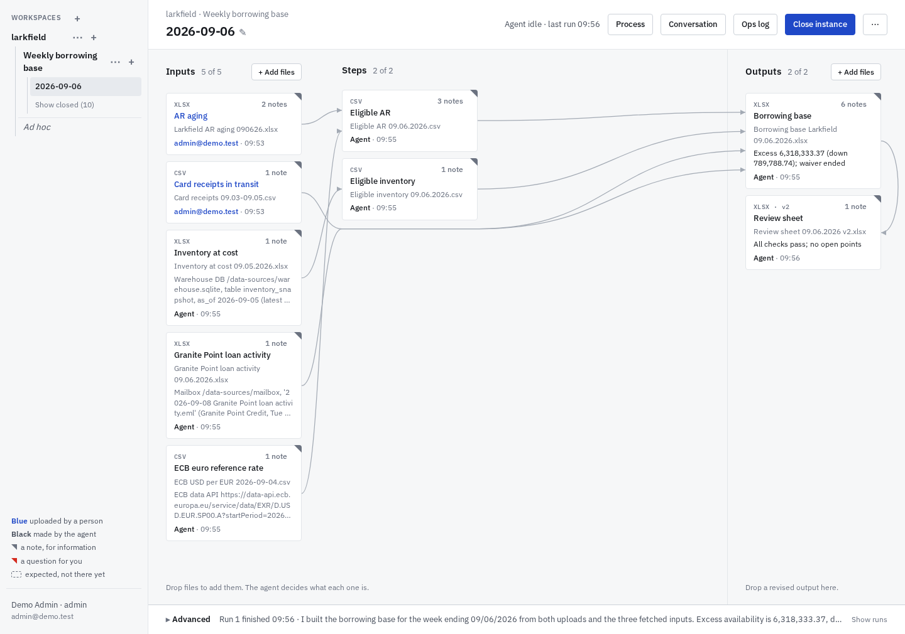

# rollforward

## Purpose

An agentic system people use for their recurring work, which accretes knowledge as they use it. It tolerates imperfect knowledge and inputs, still grows with use, and needs minimal domain setup up front.

## Deploy

A Linux host, 5.14 or later, with Node 26, git, GNU tar and bubblewrap, and about 2 GB of memory for each run at once; an OpenRouter API key, and Exa's for web search; an app registered in Microsoft Entra ID, for sign-in and Microsoft 365; and, for websites, [rollforward-browser](https://github.com/spoj/rollforward-browser) on a host of its own.

    npm ci --omit=dev && node scripts/agent.ts           # its packages, and the agent image this checkout runs
    cp .env.example .env                                 # the keys, the Entra app and RF_PUBLIC_URL
    node --env-file=.env src/server.ts DATA_ROOT 8780

[docs/deploy.md](docs/deploy.md) runs it as a systemd service that updates itself to each release.

## How

- **Accountable actions.** One series owner initiates runs across every instance, through their explicitly selected series-wide credential ceiling. Scheduled/autonomous runs need their opt-in; collaborators never initiate execution. Every act is logged, each run's changes are a git commit, and an action outside the series waits for a person to approve the agent's proposal unless the instructions say it needs none.
- **Learning from examples,** not compiled skills or a knowledge base. Each period rolls forward from the closed periods before it: their files, scripts, threads, and what was actually sent.

## Limitations

Highly agentic, with few hard guardrails. The agent does whatever its series owner's logins allow within the selected ceiling, and keeps to its instructions rather than to rules the server enforces. The ceiling applies to every instance, not one period. Every enabled workspace member may own a series; legacy roots require a manual 0.7 cutover with complete explicit owner, consent and pending-work decisions; migration apply is blocked until their evidence policy is approved. It expects accountable adults using a tool.

[docs/system.md](docs/system.md) describes the system in full.
