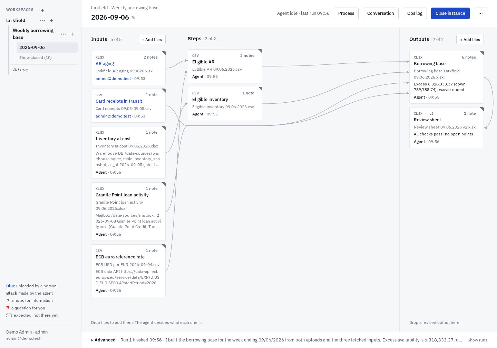
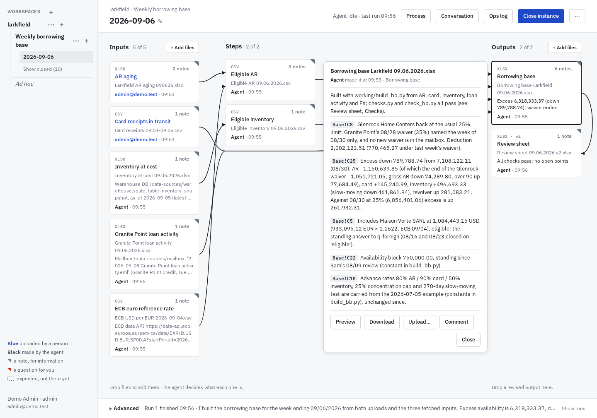
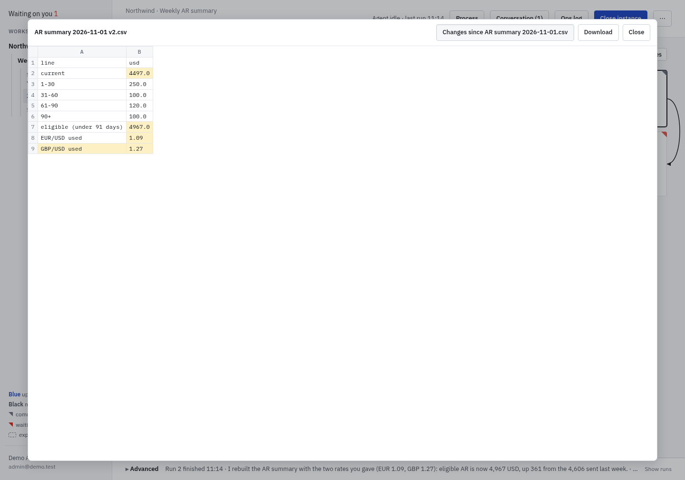
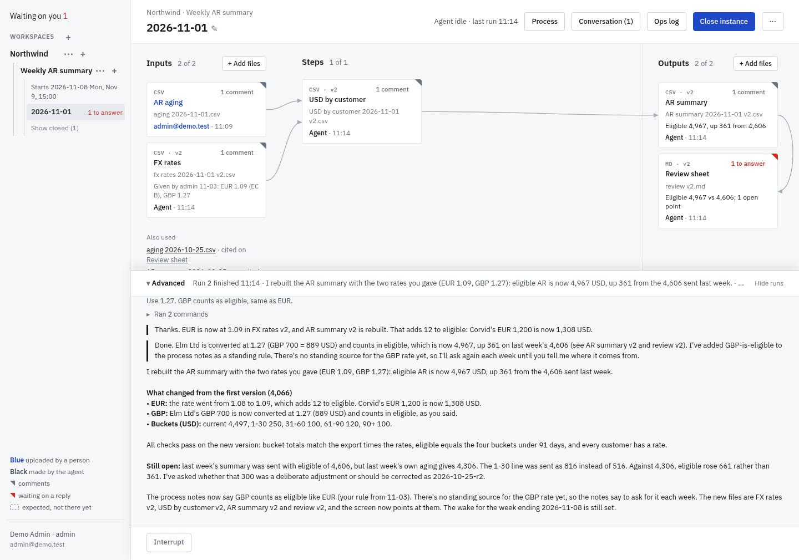
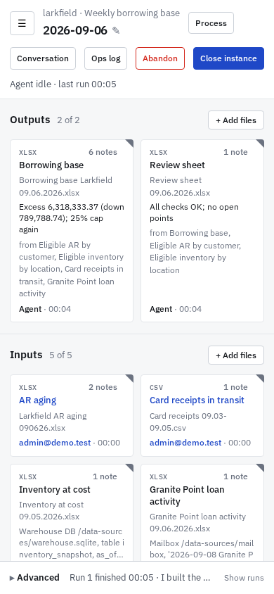

# rollforward

Recurring tasks, files in and files out. People drop this period's input files into an instance of a series. An agent learns the transform from the closed instances, produces the output files, and pins notes and questions to the cells they're about. The screen shows the work as a graph, from the inputs through the agent's steps to the outputs. People answer by clicking an option, drop in a corrected file when one was wrong, and close the instance when it's done. There is no prompt box on the main screen.

- **The agent** is [Pi](https://www.npmjs.com/package/@earendil-works/pi-coding-agent), run over RPC with read, bash, edit and write tools, in its series' folder. It copies and adapts the previous instance's scripts, so each instance's `working/` is a complete record of how its outputs were made.
- **Skills** reach systems outside the series, for the series that choose them. They are each deployment's own, in the folder `RF_SKILLS_DIR` names; none ship with this repo.
- **Inputs** are uploads, or sources a person points the agent to, such as a database, a mailbox folder or a web API. The agent keeps a frozen copy of what it read, and the tile shows where it came from.
- **Workspaces hold series,** such as one client's. Each belongs to one person, who alone sees it, besides admins. A workspace or a series can be archived, which hides it until it's restored.
- **People sign in with Microsoft,** with one button.
- **Skill use:** a series picks skills, such as fetching the day's A/R aging from OneDrive or a customer's payments from its vendor portal. Admins set each up once, with its links and, for a website, the account the server signs in with; the agent never sees the password.
- **Series can share.** A series can let other series read it, one way.
- **Everything is files on disk.** Each instance has `upload/` (people's files), `working/` (the agent's), `workspace.json` (what the screen shows) and `log.jsonl` (every event).

| A tile's notes | Preview, compared with the file it replaced |
|---|---|
|  |  |
| **Advanced: the agent's work** | **Phone** |
|  |  |

## Try it

    cp .env.example .env          # set OPENROUTER_API_KEY, and RF_SKILLS_DIR for your skills
    docker compose up --build     # then open http://127.0.0.1:8780

The image comes with a demo series that is already populated: a weekly borrowing base for a made-up housewares company, nine weeks the agent has done.
- **Week 08-16:** the agent starts fetching the inventory from a warehouse database, the lender's figures from a mailbox and the EUR rate from the ECB.
- **Week 08-30:** it handles a stale snapshot and a one-week waiver from the lender.
- **Week 09-06:** open it and drop the two files from `demo/try/2026-09-06/`. The agent fetches the inventory from the warehouse database, the loan activity from the mailbox and the EUR rate from the ECB.
- **Things to open:** a tile, Preview, the ops log and Advanced.
- **Running the agent:** create an instance and drop files. A normal week costs about $0.20–0.60 with Claude Opus 5.5 through OpenRouter.

## Access

People sign in with one button, **Sign in with Microsoft**, and type nothing.

- **Demo (the default):** the button leads to a picker of two demo accounts: `admin@demo.test`, an admin, and `bob@demo.test`, a user. Anyone who reaches the site can be the demo admin, so keep it on localhost.
- **Your organisation's Microsoft accounts:** with an app registered in Microsoft Entra ID, set in `.env` (see `.env.example`) `RF_OIDC_ISSUER` (`https://login.microsoftonline.com/<tenant id>/v2.0`), `RF_OIDC_CLIENT_ID` and `RF_PUBLIC_URL`, then match the app's registration:
  - its redirect: `RF_OIDC_REDIRECT_URI`, exactly as registered (by default `RF_PUBLIC_URL/auth/callback`; the site's root works too);
  - a **Web** app: its client secret in `RF_OIDC_CLIENT_SECRET`. A public client (Mobile and desktop) needs none;
  - a **Single-page application**: `RF_OIDC_SPA=1`, and no secret. The browser then redeems the sign-in, as Microsoft requires, and the server checks the token's signature.

  The same button then goes to Microsoft. `RF_ADMINS` names the admins; `RF_ALLOWED_DOMAINS` and `RF_AUTO_PROVISION=0` narrow who may come in. Start with `node --env-file=.env src/server.ts DATA_ROOT` without Docker. Microsoft takes http redirects only on localhost, so open the site as `http://localhost:8780`, not `127.0.0.1`; for others to reach it, register an https address.
- **What people see:** each workspace has one owner. A user sees only the workspaces they own, with their series and files. Admins see every workspace, give one to someone in its settings, and manage people on the Users page. The same from a shell:

      docker compose exec rollforward node src/auth.ts /data list
      docker compose exec rollforward node src/auth.ts /data add alice@example.com [admin]
      docker compose exec rollforward node src/auth.ts /data disable alice@example.com   # her sessions end at once

Sessions last 12 hours (`RF_SESSION_HOURS`). The people, the owners and the session key are in `.rf/` in the data root.

## Skill use

A series picks, in its settings, the **skills** its agent may use; choosing none is fine. A skill is what to fetch or do, and how, whole in a folder `<id>/` under `RF_SKILLS_DIR`: a `SKILL.md` for the agent, a `skill.json` naming the Microsoft 365 connections it reads through and its settings, and what it runs (scripts, or flows the server runs in the skill's website, with a `signin.ts` where signing in takes more than a name and a password).

| Kind of skill | Reads through | Fetches, for example |
| --- | --- | --- |
| A OneDrive file | M365 OneDrive | the day's AR aging file from its folder |
| A mail attachment | M365 Mail | the Excel attachment of the day's report mail |
| A vendor portal | its website; M365 Mail for sign-in codes | the portal's payments and unpaid items, as csv |

Admins set things up at the foot of the sidebar, once for every series:
- **Skills:** each skill's settings, such as a folder link, or for a website its address, account and password. Passwords are sealed in `.rf/` and never shown again, and the agent never sees them. Until a skill is set up a series can choose it, but the agent can't use it.
- **Systems:** the two Microsoft 365 apps the skills read through, each registered in Entra ID: its tenant id, client id and client secret. The server only ever reads with them: **M365 Mail** needs `Mail.Read` (best limited to its mailbox by an application access policy), **M365 OneDrive** read access to the folders (such as `Sites.Selected` with read).

**Test** on each row checks it for real; a website skill signs in, code and all. A website skill's browser stays on the site's own hosts and makes no write.

From a shell, without the model: `node --env-file=.env src/cli.ts DATA_ROOT test SKILL|CONNECTION`, and `… DATA_ROOT try aging -- python "$RF_SKILLS/aging/scripts/fetch.py"` (or `try portal -- rf flow portal/payments`) runs a skill as a run with it would. Set `RF_TODAY` in `.env` to test against a day that has data. Without Docker, the browser needs `node node_modules/playwright/cli.js install chromium` once.

To reach it from the internet, run `tailscale funnel --bg 8780`, with Microsoft sign-in configured.

For a demo run in podman behind Tailscale Funnel, the justfile has `just invite EMAIL [admin]`, `just revoke EMAIL`, `just people`, `just logs`, and `just deploy`, which rebuilds it from the committed main branch.

**Security:** each run is a sandbox. It sees its own series and the series it may read, holds no key, and reaches the internet only through the server, to package registries, GitHub and documentation sites. Anyone signed in can steer the agents of their own workspaces within that.

## Without Docker

You need Node 26, uv, bubblewrap and socat, and a systemd user session for each run's memory limits (or `RF_SANDBOX_SCOPE=` without). LibreOffice is optional, for recalculating formula workbooks.

    npm install
    uv venv .venv && uv pip install --python .venv/bin/python -r requirements.txt
    node src/server.ts DATA_ROOT [PORT]

The [justfile](justfile) has these and more as recipes; `just` lists them.

- **Model key:** `OPENROUTER_API_KEY`. It stays with the server, which adds it to the runs' model requests.
- **On a VM:** run the server as a systemd user service with lingering on, and cap all runs together with `systemctl --user set-property rollforward-runs.slice MemoryMax=50G`.
- **Environment variables:**
  - `RF_MODEL` (default `openrouter/anthropic/claude-opus-5.5`)
  - `RF_THINKING` (`high`)
  - `RF_LIMIT_MIN` (120)
  - `RF_PI_ARGS` (a JSON array of extra Pi arguments)
  - `RF_HOST` (`127.0.0.1`)
  - `RF_SKILLS_DIR`, the folder of this deployment's skills
  - `RF_SCRATCH` (the system's temp folder`/rollforward`), for each run's HOME and /tmp and the server's socket for runs
  - `RF_SANDBOX_SCOPE`, the command that gives each run its cgroup (a `systemd-run --user --scope` line; empty for none)
  - `RF_SANDBOX_RO`, more folders runs may read, separated by `:`
  - `RF_MODEL_URL` (`https://openrouter.ai/api`)
- **Hosts runs may reach,** beyond package registries, GitHub and documentation sites: a JSON list in `.rf/egress.json`, such as `["api.example.com", "*.example.org"]`.

To build the demo from scratch (about $4 of model use; the generator needs the internet for the ECB rates):

    .venv/bin/python demo/make_demo.py demo/out
    .venv/bin/python demo/run_demo.py demo/out http://127.0.0.1:8780 DATA_ROOT

## More

- [PLAN.md](PLAN.md): the design and the decisions.
- [prompt.md](prompt.md): the agent's instructions.
- [docs/design.md](docs/design.md): the look.
