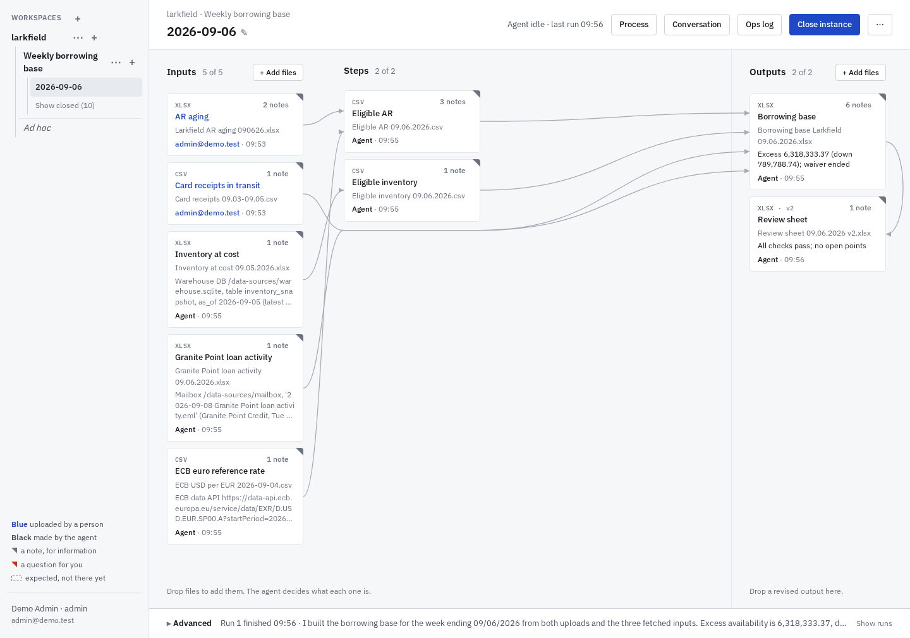
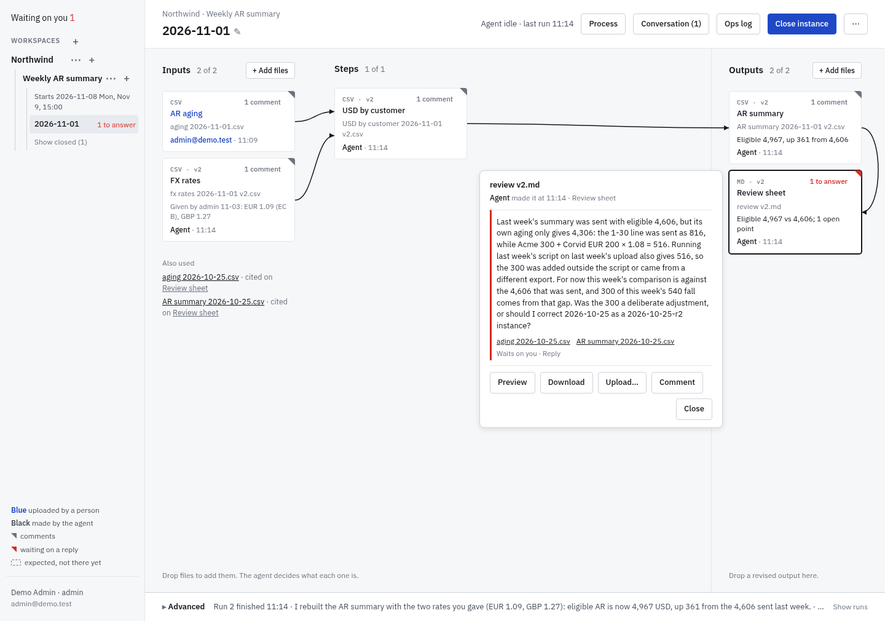
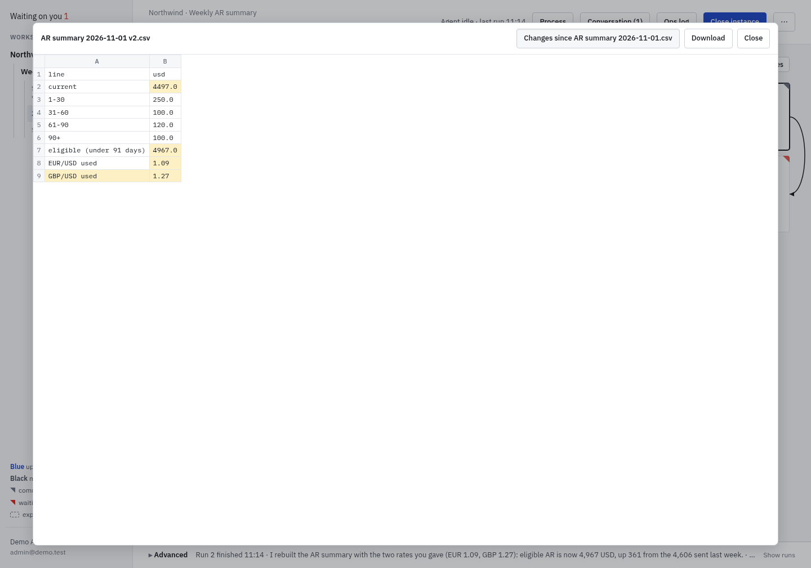
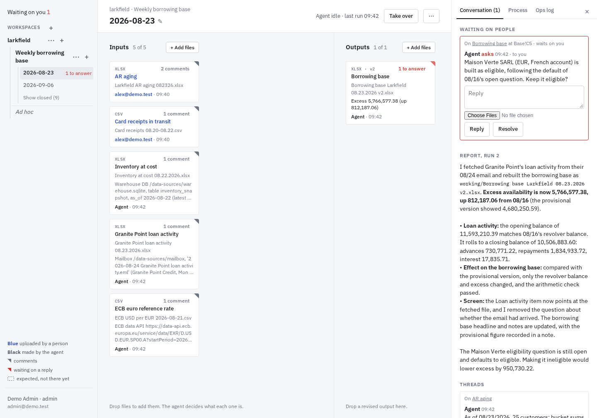
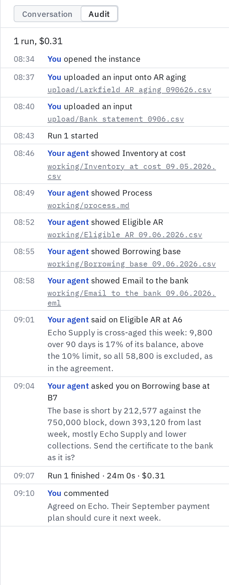
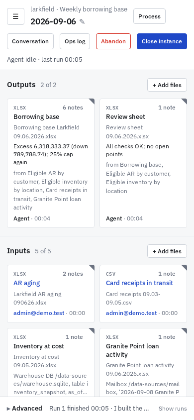

# rollforward: the system

Recurring tasks, files in and files out. People drop this period's input files into an instance of a series. An agent learns the transform from the closed instances, produces the output files, and talks in threads pinned to the cells, files and instances they're about: it says what people should know and asks what they should decide. The screen shows the work as a graph, from the inputs through the agent's steps to the outputs. People reply in a thread, drop in a corrected file when one was wrong, and close the instance when it's done. There is no prompt box on the main screen.

- **The agent** is [Pi](https://www.npmjs.com/package/@earendil-works/pi-coding-agent), run over RPC with read, bash, edit and write tools, in its series' folder, in a sandbox of its own. It copies and adapts the previous instance's scripts, so each instance's `working/` is a complete record of how its outputs were made.
- **Inputs** are uploads, or sources a person points the agent to, such as a database, a mailbox folder or a web API. The agent keeps a copy of what it read, as it read it, and the tile shows where it came from.
- **Skills** reach systems outside the series, and every run loads every live one. They are each deployment's own, pushed with `rf skill push` by admins and those they let publish; none ship with this repo.
- **Workspaces hold series,** such as one client's, and its owners and members see them.
- **People sign in with Microsoft,** with one button, and **logins are each person's own:** a run reaches Microsoft 365 and websites only through its runner's logins, and only those ticked for its instance.
- **Wakes:** an agent, or a person on the page, sets when an instance, or a series' next period, runs again, once or weekly on the days ticked.
- **AGENTS.md:** every run loads the company's and its workspace's. It finds the series it can read as folders under `/work`: its own workspace's, and those of each workspace whose owners let its workspace's agents read it.
- **rf** is people's command line, with a personal token: what the page does, but quiet, starting no run unless `--wake` (see Runs), plus `rf pull`, which copies what you can see as rsync does, 8 files at a time, for your own desktop agent, and refuses a link where one of its folders goes and a name git takes for a `.git`, and on Windows and macOS skips the second of two paths that differ only in case, saying so, `rf waiting`, what waits on you, `rf show`, an instance's items, the threads that wait on someone and its last run, `rf log`, its entries, followed as they come with `--follow`, `rf cat`, one file, what the page does to an instance, `rf approve`, `rf reject`, `rf react`, `rf close`, `rf abandon`, `rf delete`, `rf interrupt`, `rf takeover`, `rf assign`, `rf creds`, `rf rename` and `rf correct`, a series' notes, `rf note`, and what it makes, `rf new task`, `rf new instance`, `rf new series`, from a task, and `rf new workspace`, `rf share` and `rf archive`, `rf readers`, which workspaces' agents read a workspace, `rf request start|drop`, and your logins, `rf logins`, with their offers to add or take off, hosts for admins to allow and sign-outs, websites, `rf site add|set|remove`, though you sign in to them on the page, and their grants, `rf site ask`, `rf grants` and `rf grant approve|deny|revoke`, and `rf help`, its guide, or `rf help COMMAND`, a command's usage; every read takes `--json`, and a failure is one line, with exit code 1. For watching over runs, `rf status` shows what goes on and what's stuck (including a low-credit warning for admins when the server's OpenRouter key falls below `RF_LOW_CREDIT_USD` or 10% of its limit), `rf indexes` how indexing goes, `rf runs` the history of runs, each done, interrupted, cut, by a restart or a change that broke its lease, running or failed, and why (credits, policy, time limit or other), `rf costs` their totals (and with `--daily`, per-day breakdowns by workspace, person, run and server calls, plus OpenRouter key usage and unattributed difference for admins), by workspace, series, person, day or outcome, counting no run that was cut, which the next carries on, `rf activity` what people and the agent said, what people uploaded, closed and deleted, and each run that failed, per instance, and `rf wakes` each series' pending wakes and requests and when a wake last woke it, and instances' wakes. Admin is rf, not the page: `rf people` prints everyone, or a workspace's people, as lines to edit and set back with `--set`, which refuses a change that would hide an open instance from the person who runs it, unless `--force`, and `rf brand` gives the deployment its logo and text. Install it with `npm i -g @rfany/rf` ([cli/](../cli/)).
- **Stored data is files on disk,** with no database.

| A tile's card and its threads | Preview, compared with the file it replaced |
|---|---|
|  |  |
| **What needs you, above; then the threads and runs** | **The audit: the log and the agent's steps, a plain line each** |
|  |  |
| **Phone** | |
|  | |

## Try it

    cp .env.example .env                  # set OPENROUTER_API_KEY, and EXA_API_KEY for web search
    docker build -t rollforward-agent agent
    docker compose up --build             # then open http://127.0.0.1:8780

The image starts empty. It signs people in through an app registered in Microsoft Entra ID, which it needs to start (see Access): set its `RF_OIDC_*` lines and `RF_PUBLIC_URL` in `.env`, and `RF_ADMINS` to your own address.

- **A new series:** make a workspace (+ by Workspaces, for admins and those granted create), a series in it, and an instance for a past period. Drop its inputs on the left and what was actually sent on the right, and close it once the agent has learned from it: closed, it's an example. Import a few periods this way, oldest first.
- **The next period:** a new instance starts empty and runs at once if a wake made it, or else at its first upload or comment: the agent rolls forward from the instances before it, fetches what it can and sets up the screen, its tiles dashed until their files come. Drop this period's files: the agent builds the outputs and talks to people in threads: it asks what it needs and says what they should know.
- **A one-off task:** the workspace's + starts one at once, Untitled, on its conversation: write what you need and drop files there, and the first comment starts the run and names the task. If it turns out to recur, make it a series as you close it, or later, closed, with Start series.

For scale, a weekly borrowing base's runs cost about $0.20–0.60 each with Claude Opus 5.5 through OpenRouter.

## Concepts

- **People** sign in with a Microsoft account. Each is a **user** or an **admin**. Admins grant **capabilities**, to people by email or Entra groups by id, with `rf can`: **publish**, pushing skills, which every run in every workspace loads, so whoever publishes is trusted with every runner's ticked logins; **create**, making workspaces, without which the + by the sidebar's filter isn't there and one asks an admin; **keepalive**, keeping one's website logins alive for up to a week, which loads the website every few minutes (Websites); and **vpn**, the optional VPN trial (VPNs). Admins have all but `vpn`, which needs an explicit grant for them too. Who is in a workspace, and all else in one, stays as its owners keep it.
- **Workspace:** a folder of series, usually one entity's work, such as its bank rec, inventory rec and borrowing base. It is the only unit of sharing: its **members** see and work in every series in it, and its **owners** also manage who is in it, each a person by email or an Entra group by id; whoever adds a group may label it, such as Finance HK. An area that needs hiding, such as payroll, is a workspace of its own with fewer people. A workspace with no one in it is the admins'.
- **Series:** a recurring transform, such as "Weekly borrowing base": each instance's input files become its output files. What an instance should contain comes from earlier instances, not from a declaration. A **task** is a one-off: a series marked single, holding one instance and named by its label, Untitled until its first prompt or a rename names it, with no settings. Made a series, as it closes or, closed, with **Start series**, which asks only the series' name, it keeps its id, files and log, its only instance until the series starts more.
- **Instance:** one pass through a series, under a label people choose, such as "2026-08-24" or "Larkfield refinancing"; instances sort by label. Up to three of a series are open at once. An instance ends **closed**, the period's record and an example for the next, or **abandoned**; whoever manages its workspace may **delete** one, in any status, leaving only its place (see Deleting).
- **Example:** a closed instance. Its inputs and outputs are an example pair, from which the agent learns the transform, writing it down as scripts and `process.md` in `working/`.
- **Item:** one tile on an instance's screen, with a stable id, a name and a kind: an input (what came in for this period), a step (an intermediate result a reviewer would check, such as "Eligible AR", in a file the agent writes) or an output. It shows a file, names the items it's made from (`from`), for people to trace a figure back, which nothing runs, and may carry a `headline`, an output's main result, or a `source`, where a fetched input came from. Replacing a file means pointing the item at a new one.
- **Run:** one stretch of agent work on an instance, started by an upload, a comment or a wake.
- **Thread:** people and the agent talking about one point, on a cell, a line, an item or the instance (see Talking).
- **Runner:** whoever made the instance or was last assigned it; for an instance a wake started, whoever shares the series. Only an **assign** changes it: a workspace's owners and admins assign any open instance of it to anyone who sees the workspace, themselves included, its runner hands their own to anyone who does, and anyone else who sees it **takes it over**, assigning it to themselves, while no run of it goes; an earlier version's `takeover` is an assign to oneself. A run going is stopped first, as Interrupt stops it, its `interrupt` entry saying who and why, so only those who may stop it assign mid-run. Logins are never assigned: taking over ticks your own, and an instance assigned to someone else has none ticked until they tick theirs. An assign draws a line: it starts no run, and nothing before it starts one. What a run had read by then is history, which is no one's word, no note, and waits on no one; what none had, whoever said it, the previous runner too, is a note, waiting on the new runner as a note does; the next run, a new session, starts on the new runner's act, or as the table says, and its first message gives those notes. An ask of the agent's from before it still waits on whom it named, else on the new runner, and their answer is an answer, as the assign changes the runner, not whom the agent asked; the instance's wakes pending as it was assigned are no one's word (see Wakes). Whom someone else assigned it to finds it under Waiting on you, as "NAME assigned you SERIES · LABEL", and in `rf waiting` and `rf status`, until they open it or act in it. Three rules keep the runner accountable, which prompt.md gives the agent too. One: the runner's word directs a run: their comments, uploads, approvals, rejections and closings, the wakes they or the runs of their instances in the series set, the instance's own though it was renamed since, and a reply, an approval or a rejection from whom an ask of the agent's named, before the line too; sharing the series is their opt-in to others', people's and agents', starting runs as them. Two: everyone else's word waits and informs: a colleague's comment, upload, approval or rejection, another instance's agent's comment (see Talking), a note on the series (see Notes on a series), a wake someone else set and what no run had read before the last assign are notes, each judged against the runner as it was said, each carrying who said it, which the next run reads, or the run going at once, shared or not; its agent uses what they bring, says where it came from, and puts what they ask for to its runner, as with what it reads for itself, in other series or in its instance's history. Three: what leaves the system waits for an approved proposal (see Talking). One function, `standing()` in [src/waker.ts](../src/waker.ts), gives each entry its standing and whether it starts a run, as the table says, a quiet entry starting none and nothing from before an earlier version's copy; a run's message marks a note's entry `note: true`, and the page reads each entry's standing from the server. Runs use the runner's logins, the ones they ticked, which they may tick anew: above the comment box until the first run, and with the Credentials chip beside their Yours, such as "Credentials: Mail · 2 folders"; a run uses those ticked as it started, a tick taken away stopping it at once and one added waiting for the next run; only the runner closes or abandons. A chip by the instance's title says whose it is, Yours or their name, and on hover or a click since when, how they came to run it, and the logins they ticked, by name; in the sidebar, an instance or task someone else runs carries their initials.

  | Who said it | Series no one shares, or someone but its runner shares | Series its runner shares |
  |---|---|---|
  | The runner: a comment, upload, approval or rejection | Their word; starts a run | Their word; starts a run |
  | A wake the runner, or a run of an instance of theirs in the series, set | Their word; starts a run | Their word; starts a run |
  | Whom the agent's ask named, answering it: a reply, an approval or a rejection | An answer; starts a run | An answer; starts a run |
  | A colleague: a comment, upload, approval or rejection | A note; starts none | A note; starts a run |
  | Another instance's agent: a comment | A note; starts none | A note; starts a run |
  | A note on the series | A note, in a run's first message or at once to a run going; starts none | The same |
  | A wake someone else set | A note; starts none | A note; starts a run |
  | The person pressing Start on a request | Their word, as runner of the instance it makes, the request's own wake a note; starts a run | The same |
  | Anything from before the last assign | What a run had read by then: history, no one's word, waiting on no one; what none had: a note; starts none; a wake pending then comes as a request to wake the instance, which waits on its runner | The same, but a wake pending then fires as a note, which starts a run |

- **Login:** a person's own sign-in to a system, Microsoft 365 or a website, offering runs what it reaches: mailboxes, files, a site. A run uses only its runner's logins, only those ticked for its instance, a website's only where the runner's grant to it in the instance's workspace is approved, and none once the runner is disabled or out of the instance's workspace, until someone takes it over.
- **Grant:** a person's use of their login to their website in one workspace, which they ask for, saying what for, once signed in. Its owners, or an admin, approve or deny the account's use, not hosts; a general-purpose or high-risk website needs an admin. Asked by someone who may approve it, it's approved at once. Owners revoke at any time, as the person may withdraw it (Grants).
- **Skill:** what the agent knows how to fetch or do, and how, whole in a folder, such as the day's AR aging from OneDrive. Every run loads every live skill, so the company's skills are few and chosen with care. Nothing writes to a system outside rollforward: a write the work needs, such as vouchers for the ERP, is an output people take onward.
- **Reach:** a workspace's agents read its other series, and those of each workspace whose owners, or admins, let them, in its settings or with `rf readers`, choosing among the workspaces they see: a payroll workspace's agents read the entity's main workspace once its owners let them, never the reverse unless payroll's owners let them too. They never write there. Letting another workspace's agents in shares what they read with its people, whoever its owners let in, now and later, as sharing a folder with a team does; who is in either workspace changes nothing of it. The owners of either side take a link off, and taking it off, or a series moving out of reach, cuts a run reading it (see Runs); what runs copied in stays the workspace's.
- **AGENTS.md:** the company's, the admins', and each workspace's, its owners': conventions, and changes that cut across series, such as a renamed entity, which each series adapts to at its next run.
- **Archive:** a workspace or a series no longer in use leaves the sidebar, but for Archived in its menu, until it's restored. Archived, nothing in it changes and none of its instances runs: it is read as it is, and every act in it is refused, a comment, an upload, an approval or a rejection, a new instance or series, a rename, a change of its people or settings, but restoring it or deleting an instance (see Deleting). One with a run going is archived once the run ends; what waited for a run as it was archived runs once it's restored. Archiving cancels its wakes, weekly ones too, and its requests for good, as its dialog and `rf archive` say: restoring brings none back.
- **Merge and move:** a workspace's owners, or admins, propose in its settings to merge it into another workspace, or to move one of its series there, choosing the one beside the other, as a line under them says what Propose would ask, and that one's owners, or admins, accept or decline it in Waiting on you within a week, while whoever proposed it still manages the workspace; a workspace is in one proposal at a time, and an archived one in none. The one accepting sees first what moves, a merge's series made since it was proposed marked so, and the AGENTS.md it adds. Accepting moves the series as they are, cutting their runs that are going, which carry on there (see Runs), so their instances, wakes and requests go too, each under its name, numbered where that workspace has it already. A merge makes everyone in the merged workspace a member there, or an owner where the one accepting says, and adds its AGENTS.md to that one's under its name, and the merged workspace's links go, both those letting others read it and those letting it read others, as do proposals into it and its grants, which its people ask that one's owners for anew; a series moved alone leaves out whoever runs its open instances but isn't in that workspace, unless the one accepting adds them. Shared series stop being shared until their sharers share them there. Each moved instance's log says so, new to everyone but who accepted, and the workspace a series left shows it go for a week.

## The page

- **The sidebar** is a tree of workspaces, in bold, series, in a colour of their own, and instances, folded as a file browser's: selecting a row opens it and the rows above it, and leaves the others as they were; from then on its chevron alone folds or opens it, selected or not; an open series lists its open instances, then "Show closed", which lists that series' closed ones, then **Notes**, its notes thread, with how many are open (see Notes on a series), and a workspace's tasks come last, under Ungrouped, which is no series, with a "Show closed" of its own. Rows come newest activity first, as in a chat, unless its menu sorts them by name: a workspace by the newest activity anywhere in it, and a series or a task by its newest instance's, an instance's activity being its latest log entry, or now while it runs. A series' instances keep their labels' order. Each row shows how long ago its last activity was, as now, 5m, 3h, 2d or 7w, or a spinner while a run goes; a workspace's or series' gives way to its ⚙ and + on hover. A row keeps to one line, a long name cut short and whole on hover; an instance's asks waiting show as a red count, and a series' open instances as a count while it's folded. **Filter,** at its top, keeps as you type to the rows whose names match and the rows that hold them, opened as it goes; a workspace or series that matches shows its rows as ever. **Mine,** beside it, shows only the open instances you run, and the one shown, with the rows that hold them, their marks, counts and activity theirs alone, and the series and workspace shown, though you run nothing there, as this browser keeps it for you, as `rf ls --mine` lists them. The button after it opens a menu: **My workspaces**, those you own or worked in, by running, commenting or uploading, and the one you're in, or **All workspaces**; **Archived**, there while anything is; and the order, **Newest activity** or **Name**. It's marked while it isn't as it starts, and this browser keeps the workspaces and the order it chose. The site's bare address, or one naming nothing you see, opens the sidebar's first workspace, at its series with the newest activity, and the address then names what it shows. The + beside it makes a workspace. A row's ⚙ opens its settings, where it is renamed and archived, and its + starts a task in a workspace or an instance in a series; both show on hover, and a task has neither. **New to you,** as in a chat: an instance where someone else or the agent did something since you last viewed it, a run ending, a comment, an upload, an assign or a close, is in bold with a blue dot, and so is a folded workspace or series with one inside; a red dot, for an ask waiting, comes first. What you've seen is the server's, kept per person from their first look, so it follows them across browsers; viewing an instance sees it. **Waiting on you**, at the top when anything does, lists the asks and notes for you, counting each instance's questions, proposals, asks from before the two and notes, the instances someone else assigned you, until you open them or act in them, requests to start a series or wake an instance, requests to use a website in a workspace you manage, each with Approve and Deny, your expired logins, and, for admins only, the hosts a run's browser was refused that the server's check rated high risk or found at an internal address, with why and Allow (see Hosts). At its foot, **Settings** opens one dialog with tabs, Logins and Tokens; under it is the version the server runs, and « folds the sidebar to a rail, as this browser keeps it, from which », marked while anything waits on you, or a key that moves through the sidebar, opens it again. The colours' key is a chip on the canvas, shown on hover or with `?`, which also lists the keys: with no field focused, `j` `k` move through the sidebar's rows, `h` `l` fold and open them, Enter goes, and `c` goes to the comment box; Ctrl+Enter, Cmd+Enter on a Mac, sends the comment or reply being written, including a reply under a reply, once, as a second press while it sends does nothing, and Esc leaves a field.
- **The version** the server runs, as git describes its checkout, shows at the sidebar's foot.
- **The top bar** names the app and what the page shows, and you, by your initials and address, whose menu has your name, an admin's role, and **Sign out**.
- **The brand,** the deployment's logo and text, tops the sidebar, level with the top bar, and is the page's title and icon. Admins set it with `rf brand`, and the page shows it from its next load; unset, there is none. Where it has no logo, the theme's shows in its place, if the theme has one; the sign-in page's box shows the same logo, if there is one.
- **The theme,** the colours and type of the page and the sign-in page, is the default's, [web/css/](../web/css), or a deployment's own, which `RF_THEME` names as the server starts by the absolute path of its stylesheet, kept outside the checkout, on the default's tokens, with its logo of the same name beside it. The layout is the same in each (see [design.md](design.md)); the colours this description names are the default's.
- **An instance** is three slices side by side, each scrolling on its own: Inputs, Steps, the agent's intermediate results, and Outputs. A tile shows its item's name, file and version, and who made it, by colour: blue for a person, black for the agent. Dashed tiles have no file yet. A corner marks a tile with threads, gray, or red while an ask waits on a reply. Hovering a tile outlines it and shades what it's made from, and, fainter, what those are made from, all the way back, and its card names those, each a link to its card. A click opens the tile's card: on a desktop, its file's preview, to scroll in place, its threads, Open full, Download and Comment, a file dropped on the tile uploading onto it; on a phone, its threads, Open full, Download, Upload and Comment. Under the inputs, "Also used" lists the files the agent's comments cite and no tile shows. **Tiles | List,** on a desktop, kept in this browser, shows Inputs, Steps and Outputs as lists, one over the other: a row an item, with its name and file, an input's source, what a step is made from or an output's destination, who made it and when, an output's headline, whether its file changed since the series' latest closed instance before it, by content (new, changed or same), whatever its size, and its threads; a row with no file yet says only that, as its tile does. A click on a heading sorts by it, a second reverses it; a row opens its card, and takes a drop as its tile does.
- **Drops are hints.** Outputs and the rest are the two drop zones. The server adds each dropped file as an item at once, even mid-run: an output if it was dropped on Outputs, else an input. The agent decides what it is, such as a replacement for an input's file.
- **Preview** shows a spreadsheet as its workbook does, with its number formats, bold, colours, column widths and merged cells, and without its hidden rows and columns, and with its threads' cells marked. A merge covers only the rows and columns the preview shows. It opens on the sheet the workbook opens on, with hidden sheets dimmed after the others, each sheet read as it's first shown. An email, `.eml` or `.msg`, shows as it was written, in a frame that runs and loads nothing, with its own images, and its attachments open in its place. A PDF shows as its pages, each as it comes into view, and a Word document as its headings, paragraphs, lists and tables, or, with **Exact layout,** as LibreOffice lays it out. A CSV is read as UTF-8, or else GB18030, by the delimiter it uses; a click on a cell comments on it or opens its thread. An item's markdown shows each line but a heading or a table's as a point, which a click comments on, at its opening words, or opens its thread, its threads' points marked. "Compare with previous" marks the cells that changed since the file it replaced. The server reads the file for it in the agents' sandbox, with no network, two files at a time, and keeps what it read by the file's name and the content the sandbox was given, in `.previews/` in the data root, until it restarts.
- **Sources and destinations:** an input says where it came from, uploaded by whom and when, or the agent's `source`, the system it fetched it from; an output may say where it goes, its `destination`, free text the agent writes as the series' instructions name it, such as a mailbox and its recipients or a SharePoint folder, and stays here without one. Each delivery is a `delivered` entry, with where it went and its receipt, which the agent records with `rf delivered ITEM --to WHERE --receipt WHAT`, such as a message's Message-ID or a website's document number; the run's `call` entries, or its browser's requests, bear it out. The output's tile shows its destination and last delivery, and its card every delivery.
- **Needs you,** a strip above the instance, there only when something is: each thread waiting on you, a question, a proposal or a note, with a button to it, Reply, or a proposal's Approve and Reject, and each login of yours that expired under the instance, to sign in to again. Above it, while an update drains the server, a quiet line says how many runs it waits for to finish and that new runs start after it.
- **The side panel,** beside the instance where there's room for both, is its conversation. One toggle at the bar's end, the same open or closed, opens and closes it, with what waits there as its badge; on a phone it covers the page, and its × closes it. Its inner edge and the sidebar's drag to widen or narrow them, within bounds, and the browser keeps the widths; a double-click on an edge resets it.
- **Conversation:** read as a chat: the threads and the runs, oldest first, a thread where its last word is, so a reply takes it to the foot, and a run where it ended, below the comment that started it; and the box to comment on the instance, fixed at the panel's foot. A half-written comment or reply and its picked files stay with their instance while the page stays open, and its text through a reload of the tab, as when a lapsed session signs in again, and hold its conversation still until sent or cleared, but a closed box's don't, and approving or rejecting clears the proposal's boxes; sending posts to that instance even if another is opened while its files upload. The page hears of changes as they happen; while the server restarts, as behind a proxy answering 502, it waits for it, reloading only to sign in again, and catches up once it's back. It opens at the latest and keeps there as posts come, unless the reader has scrolled up. A run is one line, "Run 5 · done · 2m 0s · $0.40", opening to why it failed, the latest open. Where a run added rules to the process, or reworded them, the thread whose entry started it says "Process: +1 rule", which opens the process.
- **Process:** the instance's `working/process.md`, the method as people read it, which the agent is asked to show as its first step. It names what the agent carries from earlier instances, such as a template or a sample, which isn't an input.
- **Audit,** the side panel's other side, by the Conversation | Audit switch at its top, a half-written comment waiting meanwhile: who did what and when, oldest first, opening at the latest, under what the runs have cost: the log, and from the agent's sessions their messages and tool calls, one plain line each, a step with its output's first line. A screenshot of the run's browser, taken after each tool call that changed its page, shows on its line and opens in Preview, as earlier files do.
- **The bar** says what the agent is doing: working on run N, with **Interrupt**, which stops the run; queued; idle since its last run; or that its last run failed, with why on hover. In an archived workspace or series it says **Archived · read-only**: changes are not offered, its settings are read-only with **Restore**, and files, previews, the conversation, Audit and downloads are read as ever. For those who manage the workspace, **Delete…** follows it, on any instance but a deleted one, archived or not, which the bar says was deleted, by whom and when (see Deleting).
- **A run's browser,** while one is open, plays live in a corner of the instance for whoever sees the instance to watch, never to drive, until they no longer may, as when taken out of its workspace or disabled, which cuts it. One shows at a time, the others a click away, folded or open as the person last left it, which the browser keeps. **Stop browser** is Interrupt: the run stops, and its browsers close; only the instance's runner, the workspace's owners and admins see it, or Interrupt, and may stop a run.
- **Close** is the runner's, whenever no run goes: it makes the instance the period's record and the next period's example, and approves nothing; its dialog lists the asks still waiting, whose answers closing takes as what the agent did. Others see **Take over**, which makes them the runner, with their own logins ticked, while no run goes, or, for those who may stop it, saying it stops the run going; its runner and the workspace's owners and admins see **Assign…** too, which makes whoever they pick of those who see the workspace the runner, saying likewise that it stops a run going; either stops only the run it said, refusing one that started since (see Runner). **Abandon instead**, a quiet link in the Close dialog, ends it otherwise: it is neither an example nor a starting point. A task's Close dialog weighs its two ways the same: **Close task** closes it as a one-off, and **Start series and close**, with the series' name beside it, makes the task that series' first instance. All three wait for the run to end. Moving to another address closes any confirmation or naming dialog without acting. Earlier versions could copy a closed or abandoned instance into an open one; such copies keep working, read from their log's latest `duplicate` entry: whoever copied it is its runner until an assign, the page says it was copied and from what, its runs and cost count only those since, and what came before is history: no ask or note of it waits on anyone or starts a run, its proposals take no approval, refused with 409, and its outputs show no deliveries. An instance's label changes by clicking it, in any status outside an archive, even mid-run, as a series' and a workspace's names do in their settings; a former name is free for another.
- **Starting an instance** asks for its label and its **Credentials,** which of your logins it may use, every time, as does taking over, and before its first run its runner may tick them anew where they write its first comment; each says by its button, in red, that by clicking it you agree that agents carry these credentials while acting as you. The ticks go by kind: Microsoft 365's sources under a tick of their own, which ticks them all, folded unless some are ticked and some not; an expired login is flagged, its ticks off.
- **Logins,** under Settings at the sidebar's foot, put what needs you first: a login to sign in to again, a Microsoft 365 login to reconnect for a permission the server now asks for, or your own model key out of credits. Then a line for each, Microsoft 365, Databricks, the websites and the model key, whose sources, warehouses, sites and key box open in place, each with a box to add one by its link, a website by its name and address, and, under each website you're signed in to, your grants to it and a box to ask to use it in a workspace (Websites).
- **Series settings:** its name, who starts its runs, its wakes and its cost. **Sharing** a series lets people in its workspace and their agents wake it as you, with the credentials you tick: their comments, uploads and wakes in your instances start runs, and a wake starts an instance, which you run. What they say stays a note (see Runner). It takes two clicks, the second, "Allow WORKSPACE to wake this series", under its Credentials and what people there and their agents may then do as you, and one person shares a series at a time: anyone may share it as themselves instead, but only they, or the workspace's owners, stop sharing it. Its wakes, and an open instance's, from the wake button in its bar, **No wake** or the next wake's day, are added, changed and deleted there, each once or weekly, with a message for the run it starts if you like. An open instance's bar has one button besides, Close or Take over, with Assign… beside it for its runner and the workspace's owners and admins, and a closed task's Start series. **Workspace settings:** its name, its people, what its agents read and which workspaces' agents read it, which its owners add, among the workspaces they see, and take off, and its AGENTS.md.
- **On a phone,** the slices stack as tiles, Outputs first, then Inputs and Steps.

## Talking

Talk is threads only, as `comment` entries in the instance's `log.jsonl`: `{thread, item?, ref?, parent?, text, files?, ask?: "question" | "proposal", to?: email}`, an ask from before the two `ask: true`, which may have been either. The first comment carries the thread's place, an item and a `ref` in its file such as a cell, or a markdown line by its opening words, or neither for the instance, and its seq names the thread, `c` and the seq; a later comment replies under one of the thread's comments, its `parent`, which a reply names as `cN`, so a thread is a tree. The panel shows it as one, three levels deep, past which **Continue this thread** opens the rest on its own; a long comment folds until **More**. A comment's twisty collapses it, with what hangs under it, to its first line and a count of the rest, which this browser keeps until someone adds to it, so what you've read stays out of the way. Each comment shows its `cN` beside its time, which copies an address, `#/<instance id>/cN`, that opens the page at it.

- **People** comment on the page, from a tile's card, a cell or a line in Preview or the Conversation, with attachments kept in `upload/attachments/`, or with `rf comment`. Comment and Reply from a card or Preview show the conversation in place of Audit and focus the box there. The runner's comment starts a run, as anyone's does in a shared series, unless it's quiet, as rf's are without `--wake`; a reply to a question is its answer.
- **The agent** speaks on the most specific place it can:
  - `rf say [--in cN | --on ITEM[@REF]] TEXT`: a fact, which needs no reply, such as a value carried rather than computed;
  - `rf ask [--in … | --on …] [--to EMAIL] TEXT`: a question, for information, anything a reviewer might decide differently, warnings included, which needs a reply, labelled "asks" in red, with Reply;
  - `rf propose [--in … | --on …] [--to EMAIL] TEXT`: a proposal to act on the runner's behalf, saying what it will do and linking what it uses, labelled "proposes" in violet on a violet band, with Approve and Reject, each opening a box for an optional note, and Reply, whose box says a reply approves nothing;
  - `rf withdraw cN [--see cM] REASON`: its own question or proposal still waiting, logged as `withdraw` `{thread, on, text, see?}`, `see` the seq of the comment where it was answered. The withdrawn comment stays, greyed, as one line, "withdrawn: REASON" and a link to `see`, which a click opens to what it said.

  An ask is a question or a proposal; one from before the two shows Reply, Approve and Reject. In its text, `[name](PATH)` links a file and `` shows an image, PATH under `upload/` or `working/` of the instance, or `../<label>/…` of another of its series, which may hold spaces and one level of parentheses, as `TB (final).csv`, and a link's an `&`; a link opens the preview. `[name](#cN)` links a comment of the instance and `[name](../<label>#cN)` one of another of its series, as does a bare `cN` in a post, a comment's seq in the instance, but for one right after a letter, a digit or any of `/.#-=&;!:?`, as in an address, a query or a cell's: a click shows it, its thread unfolded, a withdrawn ask above it opened, and its instance opened, marked a moment, and hovering names who wrote it and its first words. So does `[name](#cN)` in a markdown file the preview shows. A person's comment keeps its attachments' paths in `files`, and older comments of the agent's the files they pinned, as `{inst, path, sha256}` or as they gave them; an image among them, png, jpg, gif, webp or svg, shows in the thread, and opens in the preview.
- **Another instance's agent** says something in an open instance of its own workspace with `rf say --at PATH [--in cN | --on ITEM[@REF]] TEXT`, its threads and items: a `comment` there with `by: "agent"`, `note: true`, its `run` and `runner`, and `see`, its own instance and the thread its run started from, a note for that instance's runner (see Runner), shown as "Agent of LABEL, for NAME"; its own instance logs `said`, with where it went. It asks and proposes only in its own instance: `rf ask`, `rf propose` and `rf withdraw` go to no other.
- **Who waits on what:** an ask of the agent's waits on `to`, or else the runner, as one from before the last assign does whoever it named, and a note on the runner, unless they said it themselves: a question until a person replies under it, a proposal until someone approves or rejects it, either until the agent withdraws it, and a note until someone replies under it. An ask from before the two waits until any of these, the agent's reply under it withdrawing it. Any other comment of a person's waits on no one, but the agent picks it up at its next run. Entries from before replies named what they answer, and their `resolve` entries, answer whatever came before them in their thread. On the page, a tile's card and Preview open an item's threads.
- **Approvals are git commits, sign-offs.** Anyone who sees the instance may approve a proposal of the agent's until the agent withdraws it or someone approves or rejects it, which the server refuses again, saying by whom (an ask from before questions and proposals takes either again), from under it or with `rf approve PATH cN [TEXT]`, while no run goes: the box says the agent will go ahead with it and that the instance is committed as it is now in their name; it commits the instance's folder in their name, as it is then, its message the proposal, the note and their `Signed-off-by:`, then logs `signoff` `{thread, on, text?, commit}`, `on` the proposal's seq. Rejecting it, from under it or with `rf reject PATH cN [TEXT]`, logs `reject` `{thread, on, text?}`: the agent doesn't act on it, and carries on as the note says. Either starts a run, as a reply does, unless quiet. A reply approves nothing, however worded, and a question authorises nothing. A proposal says which runs went since it, which may have changed what it links, and the agent proposes once what it links is final and, before it acts, checks with `git diff` against the sign-off's commit that what it uses is unchanged. An action outside the series, such as sending mail, saving into a shared folder or submitting on a website, waits for an approved proposal, by default approved by the runner or by whom the proposal names, unless the series' instructions say otherwise. prompt.md's rules are defaults: the company's AGENTS.md, then the workspace's, bound the rest, and within them the more specific wins, the series' `process.md` over a skill, either over prompt.md; a rule that waives an approval comes from a person, in a thread `process.md` cites. The agent proposes as they say, and nothing else holds an action back.
- **Reactions:** anyone who sees an instance puts a thumbs up or down on it, or on any of its comments, or takes it back, closed or not, from the page or with `rf react PATH [cN] up|down|none`, logged as `react`. They start nothing: a signal kept for later, which the agent reads with its next run's entries. The page counts each, the names on hover.
- **Review** happens in threads: when the work is ready, the agent asks for it in a short post saying what to know, such as judgments, unusual items, changes since the last period, open items and assumptions, and where to challenge it, linking the outputs it vouches for and, where a post can't hold it, a write-up. People challenge it there, or at a cell or a line of any file. An image the agent gives as ``, by its path in the instance, shows in place in its comments and markdown, and opens in the preview.
- **Closing** lists the asks still waiting and accepts what the agent said it did for each, and commits the folder in the runner's name; the log records `close` with `accepted`, those asks as `cN`, and the `commit`. An accepted ask waits no more.
- **Only posts reach people.** The agent talks to them in threads alone; what else it writes, such as a run's closing message, stays in its session, which Audit shows.
- **Corrections:** a closed instance is never changed, but takes later `correction` entries, never withdrawn, `{kind: "wrong" | "superseded", item?, ref?, text, see?: {inst, label, thread?}}`, each its own commit, saying that one of its items, at a place in its file if given, or the instance itself, is wrong or superseded, and where the change is. A later run's agent adds them to closed instances of its workspace with `rf correct PATH [--on ITEM[@REF]] --wrong|--superseded [--in THREAD] TEXT`, linking its own instance and thread, which logs a `corrected` entry pointing back; people add them on the page, from an item's card, Correct…, or the instance's conversation, Add a correction, saying what, at a place if given, and another instance of the series to see, or with POST `/api/instances/ID/correct`; and a `<label>-r2` closing supersedes `<label>`, as `-r3` does `-r2`. Each run's first message lists the corrections on its series' closed instances before it, and the series list counts each instance's, the sidebar marking it corrected. The instance shows "Read with corrections (n)" above it, each one listed, and Corrected on each item's tile it names; a wrong one waits on its runner, under Waiting on you, for a week.

## Notes on a series

A series has a notes thread, for telling it something while no instance is open, or something about the series rather than one period: `notes/log.jsonl` in its folder, append-only, by seq as an instance's log is, and its attachments in `notes/files/`, each downloaded by its name there and nothing outside it. A `note`, `n` and its seq, is `{text, files?}`, by a person's email, or by "agent" with its `run`, `runner` and `see`, the instance it was left from. Anyone who sees the series reads the thread and leaves a note, on the page, from Notes under the series in the sidebar, with files, or with `rf note SERIES TEXT`; a run leaves one on a series of its own workspace with `rf note SERIES TEXT`. A note starts no run; one left while a run of the series goes reaches it at once. Each is open until a `taken` entry, acted on, saying where, or an `aside` entry, set aside, saying why, `{on, text}`, settles it: a run of the series, with `rf note --taken ID [--see cN] TEXT` or `rf note --aside ID TEXT`, its `see` its own instance and thread; or by hand, on the page, with Mark done or Set aside, the runners of its open instances, its workspace's owners and admins. Nothing is deleted: a settled note stays, folded, with who settled it, how and why. Every run's first message lists its series' open notes, with who left each and its files, and runs read each series' thread in their reach at `/work/<workspace>/<series>/.notes/`, once it has one as they start. An open instance's title counts its series' open notes, with a link to the thread. A task has none.

## Runs

- **What starts one:** a person's upload, comment, approval or rejection, or a wake, which making an instance of a series logs after its `create`, for a wake or a person, and for a request both its wake, a note unless its runner's (see Wakes), and one from the person who starts it, as they act; a task waits for its first comment, as does an instance made quietly, as the page's New instance makes one. A burst of uploads starts one run, 1.5 s after the last.
- **Quiet:** an act with `quiet`, in its body or, for an upload, as a query parameter, starts no run, nor one waiting for the next act, as after an Interrupt, and the next run reads it with the rest: its entry says `quiet: true`, a quiet close's wakes of later instances are quiet too, and a new instance made, or a request to start one, quietly logs no wake, while a request to wake an instance logs quiet wakes. rf's acts are quiet unless `--wake`. An upload or comment that starts no run, quiet or a note, and a comment's attachment, as it's uploaded, commit the folder in its person's name at once, unless a run of the instance is going, whose end commits it; the system's log records the attachment, as `attach`, as no entry of the instance's names it until its comment.
- **One run at a time per series,** at most `RF_MAX_RUNS` (20) at once, and none while less than `RF_MIN_FREE_GB` (6) of memory is free, plus 1 GB for each run started in the last minute; the rest queue. A run stops at `RF_LIMIT_MIN` (120 minutes), failed with `time limit` in its `done` entry before its sandbox stops. [src/waker.ts](../src/waker.ts) decides what runs when; [src/runner.ts](../src/runner.ts) runs one.
A startup failure before `run` is logged releases its token and series slot and tries each other due instance of that series once, never cycling between siblings on a persistent failure.

- **A Pi session carried on for an hour:** a run's Pi stays, idle, for an hour after the run ends cleanly (`RF_IDLE_MIN`), and the instance's next run within it carries the session on, as a new turn whose prompt is the new log entries. An idle Pi holds no slot of its series', and at most `RF_MAX_IDLE` (8) are idle, the longest ended first. Whatever the run would start from otherwise ends it, for a new session: an assign, new ticks, a view of the data changed, as by a rename or a series made in reach, its instance closed, abandoned or deleted, its runner no longer seeing it; so do a run that failed or was cut short, as by a model's refusal, one whose queued steer was never delivered (the next session reads those entries once, with no stale queued copy), one that left a job running in its sandbox, as with `&` or `nohup`, anything but Pi and the socat offering the server's socket, known by their PIDs there, never their names, which stops with it as before, a drain, and a restart. Each run still has its own run, done and cost entries, a continuing one's run entry naming the run whose session it continues, and its browsers close as it ends. A new session's agent knows the instance's earlier runs from the log, the files and their transcripts in `session/`, as it knows earlier instances, so no run re-reads a long conversation. A new session's first prompt reads `Instance <label>, run <n>. Its runner is <name> <<email>>, who lends you web:erp at https://erp.example.com/, m365:mail:ann@example.com (Mailbox ann@example.com). Pending wakes: <id>, starting <label> at <time>, then each mon, tue, from <who set it>, a note, saying "…". Open notes on the series: n<seq>, from <name> <<email>> at <time>, "…". New log entries:`, the wakes being its instance's and series', if any, with who set each, `a note` where neither the runner nor a run of theirs in the series did (see Wakes), and what each says, and the notes every run's first message lists (see Notes on a series), then the log lines, as JSON, since its last run: the runner, on whose behalf the agent acts, and what they lend it, each tick as its entry logs it with what it is, a website's at its address. The lines are people's acts, other instances' agents' notes, and the server's wakes, expired logins, uploads made items, renames and a run cut or failed: never the agent's own, nor the server's bookkeeping, such as a run's start and end, its hosts, browsers and screenshots, which the log keeps. A prompt mid-run lists the entries since, naming the runner again where those make someone the runner or change their ticks (an assign, new ticks). The wake after a restart names the run it cut.
- **During a run,** new entries reach the agent as a steer, as do notes left on its series, after the current turn's tool calls; entries for another instance of the series wait for the run to end. The runner records the last entry the agent has answered: when a run settles cleanly with people's entries after it, another starts at once; one interrupted or failed waits for the next act, which carries those entries on too.
- **A run is a lease** on what it started with: its runner, the logins they ticked, which it uses only while they're still ticked (see Runner), and its view of the data. Its series moving, its runner no longer seeing its workspace, or its reach narrowing, as when a workspace it reads takes its workspace off its readers, a series it reads moves out of reach or an instance it reads is deleted, cuts it at once, whatever it is doing: its token ends first, so nothing more goes out, then its browsers close and its sandbox stops; it ends as aborted, its `done` saying why, and its instance is woken to carry on in a run of the new view. A start confirms its runner's sign-in with Microsoft; if the runner changes while it waits, it starts over for the new runner. A run starts only for a runner who sees its workspace: one removed from it, before their run started or as it went, leaves the instance waiting for someone to take it over. A request it had sent goes on to its answer, logged as its `call`; only a crash, or an answer later than a stop waits for, leaves a `send` with none. A change that widens what it may read, or leaves it as it was, such as a rename or a series made in reach, waits for the next run.
- **Rules added or reworded** are counted against the instance's `working/process.md` at the start of the run, or, until it has one, the series' latest closed instance before it by label, numbers by value; one over 1 MB is none, as the server would fail to read one of any size a run may leave.
- **What a run loads:** prompt.md is its system prompt, and Pi adds the AGENTS.md files from `/` down to the instance's folder: the company's at `/work/AGENTS.md`, and the workspace's at `/work/<workspace>/AGENTS.md`. Nothing in it changes from run to run: what does is in the files the agent reads, or in its messages. Other workspaces' AGENTS.md in reach are files to read, not loaded.
- **Wakes:** `rf wake TARGET AT [--label LABEL] [--days DAYS] [TEXT]` sets one, TARGET a folder as the run sees it, in its own workspace: an open instance, which the wake continues, or a series, which it starts a new instance of, labelled LABEL, which runs as whoever shares the series, or continues the one it has by that label; unshared, or with three open, the wake shows on the page as a request to start or dismiss, which waits on whoever shares the series, else the runner of its newest instance, else the person who asked, under their Waiting on you and in `rf status`, or on anyone in the workspace if no one. `--days`, such as `mon-fri` or `mon,wed,fri`, as the page's day ticks, repeats it each week on those days at AT's time, in the server's time zone (`TZ`); a series' label then holds the date AT falls on, or that of the day before it that it fires on, and each time it fires the date moves on the same way, so a weekday job labelled by the day before labels Monday's run with Friday. A series' wake for a label it has already continues that instance, so two weekly wakes that come to one label on a day start it once. `rf wake --cancel ID` cancels one, by the ID each run's first message lists. A wake may carry TEXT, a message of 500 characters at most, kept with it, shown where the page and `rf wakes` list it, and logged in the `wake` entry the run it starts reads, with who set it. A wake, of an instance or a series' starting or continuing one, that neither that instance's runner nor a run of an instance of theirs in the series, its own among them, set is a note, which starts a run only where the series is shared. An instance's wakes pending as it was assigned are no one's word: each fires as a note, which in a series its new runner doesn't share comes instead as a request to wake the instance, under its runner's Waiting on you and in the series' rows, whose Wake, its runner's alone, as anyone else's would start nothing, logs it as a note beside the runner's own wake, which starts a run with the logins they ticked, asking none on the page. A target may have up to 20 wakes pending, in `.rf/wakes.json`: an instance's add up, the same twice being one, and a series' one-off for a label pending moves it, or is the weekly one that starts that label. A wake a person set fires only while they may still see its workspace: once they can't, as when they've left, it's gone unfired, a line in the server's output saying so. A target fires at most once in 15 minutes, a wake due sooner waiting; a clock checks them every minute, and overdue ones fire after a restart, a weekly one's missed days one at a time. Closing or abandoning an instance cancels its wakes, archiving a series or workspace cancels those of everything in it, with its requests, and nothing archived takes one. Cadence is the agent's: it sets its next period's wake, wakes its own instance for a late input, and wakes the series its outputs feed. A closed instance can't be woken: its repair is a new instance of its series, labelled `<label>-r2`.
- **Closing an instance wakes its series' later open instances,** which may have used its draft, a note for those the closer doesn't run, which starts a run only where the series is shared; a quiet close's wakes are quiet. A run that meets its runner's expired or missing login logs `expired`, as the agent does with `rf expired NAME` when a website shows its sign-in page, which records it and says so. The notice, above the open instance, in the Ops log and under Waiting on you, has a Sign in again button while they run it and keep the login ticked, and signing in again wakes the instance, unless it was assigned or the login unticked since, though assigned back to them: what came before an assign holds and wakes nothing. A wake of an archived series, or one in an archived workspace, is dropped.
- **An update drains the server before it restarts** ([scripts/update.ts](../scripts/update.ts)). On `SIGUSR2`, for `RF_DRAIN_MIN` (15 minutes) from the latest signal, the server starts no new run, drops its idle Pis and keeps none idle as runs end, and answers `GET /drained` with 200 (503 otherwise) once no run is going and the idle Pis have stopped; people's requests keep working, and acts and due wakes are logged and wait as when every slot is full. A run going is one in `active` (mid-turn, from `run` until `done`) or `retiring` (closing its browsers, stopping its sandbox and committing its folder); an instance waiting on a person's answer to an ask has ended its turn and is not going, its warm session in `idle` holding no run. A stopped sandbox leaves `ending` even if removing its scratch folder fails, so a cleanup error cannot hold the drain open. If nothing stops the server, the drain lapses at that deadline and what waited starts by itself. The updater bounds each drain probe to 2 seconds or its remaining wait, whichever is shorter; an unresponsive probe cannot extend that wait. It renews `SIGUSR2` on each poll, including its last, to keep queued runs from starting before the stop. If the updater exits after a renewal, even on a failed MainPID read, the server can still drain for one full lease from that signal; the deadline releases queued work without needing the updater. A rollback stops and starts the server too, so it clears the old process's drain. A stop (`SIGTERM`), once drained, past `RF_DRAIN_MIN`, or at once for an `Urgent:` release, cuts whatever runs still go, their tokens first, so nothing more goes out, then their connections to their browsers, and exits once what they had sent is answered and logged, 10 s at most. A run it cut ends as aborted, with what it cost so far, its browsers closing as the server starts again, and its instance is woken to carry on after the restart, unless an Interrupt or assign stopped it, which still holds across a restart unless a later non-quiet act starts work; acts and wakes that waited during the drain start through `recover()`. Indexing goes on from its `.json` files.

## Deleting

An instance can hold what shouldn't be there, such as personal data in an upload or a password in a comment. Whoever manages its workspace, its owners and admins, deletes it, open, closed or abandoned, a task too, in an archived workspace or series as well: with **Delete…** on the bar, `POST /api/instances/ID/delete` or `rf delete PATH`; people only, never a run. It can't be undone: the page asks once, saying so and that copies outside the server stay, instances copied from it, files other runs copied, `rf pull` copies and mail sent, as rf does, which takes `delete` typed, or `--yes`.

- **What's cut first:** a run going, queued or idling for it, as a lease is cut, its token first, then its browsers and its sandbox; and any run, going or idle, whose view holds it, which carries on in a run of a view without it. Its wakes go, and its series' one-off wakes and requests for its label, or all of a task's. The server waits for those runs' sandboxes and browsers to stop, including browsers still opening or already closing, and for the instance's last commit, and takes no more there. Browser logs and screenshots answering after its tombstone write nothing there.
- **What goes:** everything the server holds of it: `upload/`, `working/`, the screen's items, the log's entries, `session/`, `browser/`, `names.tsv`, `.git/`, the previews kept of its files in `.previews/` under its id (a preview still being made is discarded), and, for a task, its series' `.pylib`. Whatever a run left in its folder goes too, a folder it made unreadable opened up first, never through a link. Deletion and the `.pylib` listing walk through directory descriptors, closing each parent on descent and checking its inode when reopening it on ascent. Neither path length nor tree depth consumes a descriptor per ancestor, traversal takes linear directory opens, and errors close the descriptors too.
- **What stays:** a hole: its id, label and place in its series, shown as deleted, by whom and when, struck through among the closed; its log holds only the `delete` entry, with what its runs cost, `cost`, and each run's time, outcome, cost and runner, `runs`, so its series' and workspace's totals, and `rf runs` and `rf costs`, still count it. The system's log records it, as the person's act with the instance's path then. Nothing wakes, assigns, renames, corrects or reads it, runs in reach included, and its label stays taken; it isn't offered as a correction's reference. `rf ls` and `rf show`, with `--json` too, report who deleted it and when; `rf pull --delete` removes local copies of what went, keeping only the tombstone's metadata files even when every instance in the pull was deleted.
- **A restart** that cut a deletion finishes it: its tombstone and the system's delete act are written before waiting for sandboxes, browsers and history, so the server finds the instance deleted and clears what's left of its folder, and a task's `.pylib`, as it starts.

## The agent's rf

`rf` is on the agent's `PATH`; `rf help COMMAND` gives each command's details. What reaches outside the series is a wide path: the real interface at its real address, Microsoft Graph, a Databricks workspace, OpenRouter, Exa or a website in a browser over CDP, reached with real tools and the vendors' own docs, behind a boundary the server keeps (the connection's policy, the instance's ticks, the website's hosts) and with every request logged, not commands that wrap it (see Connections). Narrow conveniences are skills people write. For its own instance it calls the people's API, `/api`, as a caller with a run's few rights: its own instance's screen and threads, commits of its folder, wakes, corrections and notes in its own workspace, and naming a folder it can read; so each rule lives once. `/agent` holds what only a run has: its runner's browsers.

- `rf show` prints the screen, `screen.json`, with its `rev`; `rf put FILE` replaces it. A put is refused if its `rev` isn't current, as people may have uploaded meanwhile, and unless every item has a unique id, a name and a kind; `from` names items, never in a circle; `file` is null or an existing file under `upload/` or `working/`; and `status` is left as it is. The server logs each change (`point`, `item`, `remove`); the files stay the agent's to change, and the page marks a tile whose file's content changed since you looked.
- `rf say`, `rf ask`, `rf propose` and `rf withdraw` (see Talking), `rf note` (see Notes on a series), and `rf wake` (see Runs).
- `rf commit MESSAGE` commits the instance's folder, in the agent's name, at a moment it judges worth keeping, logged as `commit` with the run and the hash. The run reads the history, `.git` in the folder, with git: the log, and `git diff` for what changed since the last commit.
- `rf delivered ITEM --to WHERE --receipt WHAT` records an output delivered outside. A run's browser on a website is at `$RF_BROWSERS/SITE` (see Access), and its print browser at `$RF_BROWSERS/print`. The agent never sees a password of its runner's, nor their Microsoft or Databricks tokens, a service's key or a website's header token; but a browser's CDP is the real one, so a run can read its runner's cookies for the websites it uses through the browser, httpOnly ones too (`Network.getAllCookies`), and send them wherever its egress reaches, such as GitHub.

## Storage

Stored data is files on the host's disk, in folders named by random ids, with no database. Names live in two small files, so a rename or a move edits one of them, at any time, even mid-run.

    .rf/                      the server's own: log.jsonl (the system's log: each change a person made beyond an instance, by
                              seq, with who, the method, path and body, its secrets and files' contents left out, and the
                              server's own, such as website checks' host-only evidence, search queries and verdicts, and a
                              run's setting or cancelling a wake, with the wake and the run's instance and number),
                              users.json, tree.json, people/<sha256(email)[:16]>/ (each person's logins, their websites,
                              and in index/ their caches, see Indexes),
                              connections.json, ca/ (the runs' certificate authority), wakes.json (pending wakes and requests), egress.json (hosts runs may reach), browsers.json (the runs' browsers open on the browser service), vpns.json (the deployment's VPN definitions, never live tunnels or credentials),
                              tokens.json and token-uses.jsonl, brand.json (the deployment's logo and text), capabilities.json (whom admins let publish, create, keep logins alive or use the VPN trial), grants.json (whose logins to which websites runs in which workspace use, see Grants), internal.json (the hosts at internal addresses admins let every website reach, see Hosts), runs/<token>/ (each run's folder, holding its copies of indexes,
                              see Indexes, and naming its scratch for cleanup at the next start), and the keys session.key and seal.key
    .rf-backups/<time>/       .rf/ as each of the server's last five starts found it, but index/ and runs/, to put back by hand
      tree.json               {"workspaces": {id: {name, owners, members, archived?, proposal?, moved?, readers?}}, "series": {id: {name, workspace, archived?, single?}},
                              "groups": {Entra group id: label}}
    agents/                   company.md, the company's AGENTS.md, and <workspace id>.md, each workspace's
    skills/                   versions/<id>/<n>/, each pushed version, and live/<id>, a link to the one runs use
    series/<id>/
      series.json             {"shared": {by, since, logins}}, read-only
      notes/                  log.jsonl, its notes thread, and files/, their attachments
      .pylib/                 Python packages the series' scripts installed
    instances/<id>/
      instance.json           {"label", "series": id}, read-only
      upload/                 people's files, as uploaded, read-only; attachments/ holds comments' files
      working/                the agent's: scripts, process.md, drafts, outputs, and inputs it fetched or made
      screen.json             the screen, read-only
      log.jsonl               every event, written by the server
      session/                each Pi session, <time>_run-<n>-<random>.jsonl by the run that started it, which the audit shows
      names.tsv               the latest run's names: each instance in its reach, id<TAB>/work/<workspace>/<series>/<label>
      pylib.tsv               the series' .pylib as the latest run started: each file, path<TAB>size<TAB>change time, sorted
      browser/                each run's browser requests, one line per request, and its screenshots
      .git/                   the folder's history: a commit at each run's end, approval, close, rf commit, attachment, and upload
                              or comment that starts no run

    A deleted instance keeps instance.json, a screen.json with no items, and a log.jsonl of its delete entry alone.

- **Who writes what:** people upload, comment, approve, reject, interrupt, assign and close, through the server; a run's runner, the workspace's owners and admins alone interrupt it, and its runner alone closes or abandons it. The server adds each upload as an item at once, creates and closes instances, and alone writes the log and the history. The agent decides the items, through `rf`, and reads `log.jsonl` directly.
- **A cut write loses no file:** the logs, an instance's `log.jsonl`, a series' `notes/log.jsonl` and `.rf/log.jsonl`, are appended to, each entry on disk before the server holds it, and an append a write error cut short, as on a full disk, is taken back; a torn last line a kill or a power cut left is dropped as the log is next read, the server saying so in its own log, so it never stops a start. Every other file the server rewrites, a person's logins, websites and what they've seen among them, is written whole to a temporary file renamed into place, as a new instance's folder is from `.tmp/`, and an uncreated folder in `instances/`, with no `instance.json` or no log entry, goes as the store opens, logged.
- **`upload/` is people's:** nobody moves, renames or changes its files. Each streams to `.tmp/` in the data root as it arrives, then moves into place, read-only; it may take up to an hour, and is refused if its instance closed or its person lost access to its workspace meanwhile, or with 413 as it passes `RF_MAX_UPLOAD_MB` (2048), as are a comment's attachment and a note's file. Any other request's body, JSON or a screen, a skill push among them, holds 10 MB at most, refused with 413 as it passes that. A repeated name, or `attachments`, whose folder holds comments' files, becomes `<stem>_<n><ext>`. A name past the 255 bytes a file's name holds, as an Outlook mail saved under a long subject may have, loses the end of its stem to fit; its item keeps the whole name.
- **`.git/` is the server's,** and runs read it. Each run's end commits the folder in the agent's name, as `Run N`, with its error if it failed, once its browsers and sandbox have stopped, and the instance's next run and other commits wait for it, so a commit holds a run's changes with the `names.tsv` they were written under; a restart that cut a run commits it as it starts, and a commit that fails is logged as `commit` with its `error`. Each commit holds the whole folder, every file whatever its size or type, and links as links, but what git can't hold: names it refuses, such as a `.git`, and what is neither a file nor a link, such as a FIFO. A commit whose files to read have over 4 GB of holes in all, which sparse files read as zeros but don't hold, fails, naming the file to remove, rather than read and store what no run wrote; on a disk that compresses, such as ZFS, a very compressible file counts its savings as holes. The server reads each file itself, never through a link, and streams them to `git fast-import`, so nothing a run leaves, such as a `.gitignore`, changes what a commit holds; a file or folder a run made unreadable it makes readable again first, as their owner, and elsewhere the server takes one for none, so a run can't stop the commits, or the runs, after it; after each, it writes the index, for a run's `git diff` and `git status`. A file unchanged since the last commit, by its inode, size, mode and modification and change times, as git's own index tells, isn't read again; big files go in as they are (`core.bigFileThreshold` 64m, `gc.auto` 0). Closing packs the history, which no longer grows, into one pack (`git gc --prune=now`); a failed commit or packing leaves the instance open in memory and on disk, with no close entry. `rf pull` leaves out every name git refuses, the history and a run's `.GIT/` among them, which would be a `.git` on a disk that ignores case, as on a Mac or Windows, whose config runs commands as git runs there; and rf itself refuses to write one, whatever a server lists.
- **`working/` is the agent's,** to change as it works, shown files included; every commit keeps them as they were, and `git log` and `git diff` show what changed.
- **A closed instance's `screen.json` is its example pair:** the items and the files that were actually used or sent; closing refuses if an item's file is missing.
- **Logins are sealed:** each login's secret, Microsoft's refresh token or a website's browser state, is AES-256-GCM, with the person and the login's id as authenticated data, so a record copied to another person's folder won't open. Signing out deletes it.
- **Addresses use ids,** such as `/api/instances/<id>`, `/files/<id>/…` and the page's `#/<id>`, so links survive renames; a run sees names instead (see Sandboxes), and the files it writes use them, so its instance's `names.tsv` maps each name it saw to its id, and a commit holds the table its changes were written under: a path that no longer matches is found by its id there.

## The screen and the log

The screen, `screen.json`:

    {"rev": 31, "status": "open", "items": [
      {"id": "ar-aging", "name": "AR aging", "kind": "input", "file": "upload/AR aging 082426_2.xlsx"},
      {"id": "inventory", "name": "Inventory at cost", "kind": "input", "file": "working/Inventory at cost 08.23.2026.xlsx",
       "source": "Warehouse DB, snapshot 08-23, read 08-24 09:12"},
      {"id": "eligible-ar", "name": "Eligible AR", "kind": "step", "file": "working/Eligible AR 08.24.2026 v2.csv", "from": ["ar-aging"]},
      {"id": "borrowing-base", "name": "Borrowing base", "kind": "output", "file": "working/Borrowing base 08.24.2026 v3.xlsx",
       "from": ["eligible-ar", "inventory"], "headline": "Excess 1.2M, 0.3M less than last week"}]}

`log.jsonl` has one line per event, in `seq` order, `by` a person's email, "server" or "agent"; unknown fields are ignored. Each names its source, so every act traces to a person: a person's by their `by`; the agent's, and the server's within a run, by their `run`, a correction's in the instance its `see` names, as is another instance's agent's note, which names its `runner` too; the rest by their `cause`, the seq of the entry they follow from, or, for a wake, by `from`, who or which instance set it, with its `text`. A person's act and the wakes it makes may say `quiet: true`: they start no run (see Runs). The ops are `create`, `upload`, `point` (an item now shows a file), `item`, `remove`, `run` (a run's lease: its `runner`, one for all of it, `consent`, the seq of the act that ticked the logins it may use, which it uses only while they're still ticked, and `agents`, the sha256 of each AGENTS.md it reads, by its path in /work, and `pylib`, the sha256 of its series' `.pylib` listing as it started, the instance's `pylib.tsv` then), `done` (with the run's `cost` in USD, the sum of what the proxy recorded for its calls to OpenRouter and Exa, and `estimated`, `false` when every call's cost came from the provider or `true` when one or more fell back to an estimate; earlier entries have no `estimated` field), `comment`, `signoff` (someone's approval of the proposal it names, `on`, with its `commit`; earlier versions logged a rejection as one with `approved: false`), `reject` (someone's rejection of the proposal it names, `on`), `withdraw` (the agent's of its question or proposal `on`, with `see`, where it was answered), `react` (a person's thumbs up, `up: true`, or down, `false`, or neither, `null`, on the comment at seq `on`, or on the instance), `resolve` (from before replies named what they answer), `commit` (the agent's, with its `message`, the run and the `commit`), `said` (the agent's note in another instance, by its `inst`, `label`, `seq` and `thread`), `interrupt` (with `why`, where it stopped a run for an assign), `close`, `abandon`, `delete` (the one entry a deleted instance keeps, see Deleting), `duplicate` (an earlier version's copy of the instance `from`, see Close), `rename`, `assign` (who made `to` the runner, `from` whom, with the `logins` they ticked taking it over themselves), `takeover` (an earlier version's assign to oneself), `promote`, `move` (by whoever accepted it; earlier versions logged them as `accepted_by`), `wake`, `expired`, `egress` (a host a run reached or was refused), `send` (a run's request that may write, anything but a GET, HEAD or OPTIONS to a connection or an answer's link, as it goes, with its `name`, `method` and `path`, so a restart that cuts it leaves it logged as sent, though a stop first waits 10 s for its `call`), `call` (a run's request to a connection, with its `name`, `method`, `path`, the `status` answered and the answer's `bytes`, and the `send` it answers as `sent`, and, for OpenRouter or Exa, the `model` asked for, what the answer `cost` and `estimated: true` where that cost was estimated, and, for a write to a deployment's service, its body's `sha256` and `size`, and `incomplete` if it stopped short; a refusal also has the reason, `refused`; earlier versions logged `graph` entries instead), `delivered` (an output delivered, with `to`, `receipt` and the run), `browser` (a run's browser on a website closed, with its request and write counts and the `hosts` its pages were refused, or, with `action: wait`, a run waiting for its person's browser there, with who `held` it, or, with `action: drive`, its person taking control of it from the page), `shot` (a screenshot of a run's browser after a tool call changed its page) and `browsers` (a run's browsers didn't all close).

    {"seq": 40, "at": "2026-08-24T15:02:00Z", "by": "sam@example.com", "op": "upload", "file": "upload/AR aging 082426_2.xlsx", "pane": "in", "onto": null, "sha256": "9f2c…"}
    {"seq": 41, "at": "2026-08-24T15:02:00Z", "by": "server", "op": "point", "item": "u40", "file": "upload/AR aging 082426_2.xlsx"}
    {"seq": 42, "at": "2026-08-24T15:02:02Z", "by": "server", "op": "run", "run": 4, "upto": 41}
    {"seq": 43, "at": "2026-08-24T15:09:30Z", "by": "agent", "op": "point", "item": "ar-aging", "file": "upload/AR aging 082426_2.xlsx", "was": "upload/AR aging 082426.xlsx"}
    {"seq": 44, "at": "2026-08-24T15:09:30Z", "by": "agent", "op": "remove", "item": "u40"}
    {"seq": 45, "at": "2026-08-24T15:10:12Z", "by": "agent", "op": "comment", "thread": "c45", "item": "borrowing-base", "ref": "Base!C22", "text": "Sam raised the availability block from 500,000 to 750,000, which cuts excess by 250,000. One-off, or from now on? I applied it to this week.", "ask": true, "to": "sam@example.com"}
    {"seq": 46, "at": "2026-08-24T15:14:12Z", "by": "server", "op": "done", "run": 4, "aborted": false, "seen": 41, "cost": 0.21, "estimated": false}
    {"seq": 47, "at": "2026-08-24T15:20:00Z", "by": "sam@example.com", "op": "comment", "thread": "c45", "text": "From now on."}

## Harness: Pi over RPC

The runner, [src/runner.ts](../src/runner.ts), drives Pi through Pi's `RpcClient`, which runs Pi as a child process and exchanges JSON lines with it:

    pi --mode rpc --provider openrouter --model anthropic/claude-opus-5.5 --thinking high \
      --no-extensions --no-skills --no-mcp --no-prompt-templates --skill /skills/<id> … \
      --tools read,bash,edit,write --system-prompt <app>/prompt.md \
      --session-dir "/work/<workspace>/<series>/<label>/session" --session-id run-<n>-<random>

- **prompt.md replaces Pi's own system prompt,** and Pi adds the context files it finds from `/` down to its working folder, the instance's: the run's AGENTS.md files. The run's Pi home holds none, so nothing of whoever runs the server reaches it.
- **Pi's own commands drive a run:** `prompt` starts it, and `steer` delivers mid-run entries, with steering mode `all`, so what queued by the end of a turn arrives together. Interrupt revokes the run's token and cancels its in-flight OpenRouter and Exa calls before asking Pi for `clear_queue` and `abort`; it gives Pi at most 1.5 seconds to settle, drains the calls' charges, then waits for its sandbox, browsers and final commit before an assign is logged. A natural turn end already draining costs still ends as interrupted, never keeping its sandbox idle, and racing endings write only one `done`. A late prompt acknowledgement after the run ended neither steers Pi nor arms another run-limit timer. Ordered instance actions still wait for actual sandbox exit, browser closure and the final commit, with no total teardown deadline: an unkillable process or blocked filesystem can hold that instance until the host recovers; the RPC and provider-cost deadlines do not bypass that wait.
- **A session's id is `run-<n>-` and 16 random hex digits,** as Pi starts from the transcript in `session/` with its id, and runs write `session/`: no earlier run knows a later one's id to write the conversation it starts from. A run can still change any transcript there, an earlier session's too, which Audit shows and later runs read as they read `working/`; each commit keeps them as they were.
- **Each run has its own Pi home,** in its sandbox's scratch, with `settings.json`. Pi reaches OpenRouter at its own address, through the sandbox's proxy as any of the run's calls do, with a stand-in key (see Connections). `PI_OFFLINE` keeps Pi from checking for updates.
- **Pi's `agent_settled` ends a turn;** Pi exiting mid-turn fails the run at once, with its exit code or signal and stderr, and its next run starts a new session.
- **The model key,** `OPENROUTER_API_KEY`, stays with the server, whose proxy puts it in each request a run sends OpenRouter, Pi's own among them. A server without one ends each run at once with that error.
- **`--skill`** loads each live skill, and `--no-skills` keeps out the Pi skills of whoever runs the server.
- **`RpcClient` starts `node`** from the `PATH` it's given; the runner puts [bin/sandbox](../bin/sandbox) first, whose `node` starts Pi in the run's sandbox.

## Sandboxes

Each run's Pi is a bubblewrap sandbox ([src/sandbox.ts](../src/sandbox.ts)), in a systemd scope of its own (`MemoryHigh` 4 GB, `MemoryMax` 8 GB, in `rollforward-runs.slice`). It has at most `RF_RUN_TASKS` (2048) processes and threads, a fork bomb's end, and no file over `RF_RUN_FILE_GB` (16 GB), which ends a runaway write, both rlimits set inside it, where Linux 5.14 and later count its processes apart from the server's, so in a container too; nothing else bounds what it writes to `working/`, `.pylib` and /tmp but the disk, and a commit refuses files with over 4 GB of holes in all (see `.git/`). Anyone signed in can talk to the agents of their own workspaces, within these walls.

- **Its userland is the agent image,** never the host's: [agent/Containerfile](../agent/Containerfile), Debian with Node 26, Python 3.13 and its venv at `/opt/venv` ([agent/requirements.txt](../agent/requirements.txt)), headless LibreOffice, poppler, tesseract with English and Chinese, officecli, playwright-cli, ffmpeg, CJK fonts and the usual command-line tools. Pi itself runs on its node. The image's id hashes the folder's files ([src/agent.ts](../src/agent.ts)); CI publishes each id's root once, as `agent-<id>.tar.zst` in the GitHub prerelease `agent-<id>`, and every checkout, a host's or the tests', unpacks that same tarball into `.agent/<id>` with `node scripts/agent.ts`, which builds one with podman or docker if the id isn't published yet. The sandbox has the image's `/usr`, `/etc`, `/opt` and `/var`, with only the host's `/etc/passwd`, `/etc/group` and time zone; the server won't start without the image its checkout names. Previews of spreadsheets and emails ([src/preview.py](../src/preview.py)) and `cli.ts try` run in it too, so the host itself runs no Python; a preview takes a file of up to 100 MB, streamed to it, with no network, and holds 2 GB at most; a file it can't read, such as a broken or password-protected one, answers 422 saying to download it.

- **What it sees:** the agent image, the app's code at `/app` and the skills, read-only; under `/work`, its view of the data by name, built as it starts, its working directory its own instance's folder: `/work/<workspace>/<series>/<label>/` for every instance in its reach but an abandoned one, neither an example nor a starting point, and a deleted one, read-only but for its own instance's `working/` and `session/`, from which git finds the instance's repository across the mount (`GIT_DISCOVERY_ACROSS_FILESYSTEM`), and its series' `.pylib`, where a plain `pip install` puts packages, built for the image's Python, which every later run of the series runs, whoever its runner, as it does the scripts carried forward: so, as each run starts, what Python would run there unasked goes, `sitecustomize` and `usercustomize` in any form and `.pth` files, which Python reads only in site-packages, never on `PYTHONPATH`, so no package needs them there; and its listing, each file's path, size and change time, which a run can't set, is the instance's `pylib.tsv`, which the run's commit keeps, and the run entry has its sha256, so what a run left there is seen as the scripts are, though a package's own code, which may shadow the image's, runs as it is, and the AGENTS.md files and each series' notes at `/work/<workspace>/<series>/.notes/`, of a series that had any as it started, but no other series' `.pylib`, the code its runs installed, which a run in reach would run with its own runner's logins; `RF_SANDBOX_RO`, read-only; and a HOME, `/home/agent`, and /tmp of its own on `RF_SCRATCH`, deleted when its Pi stops or at the server's next start, which removes only the runs named by this data root's `.rf/runs/`. Never `.rf/`, the data root, a workspace outside its reach, or the server's environment: bwrap, a run's and a preview's, starts with none but `PATH`, as its PID 1 inside keeps the environment it started with, readable at `/proc/1/environ`.
- **Names are the run's own:** they stay as the run started with them, though people rename a workspace, series or instance meanwhile, and its instance's `names.tsv` lists each instance in its reach by them, `id<TAB>/work/<workspace>/<series>/<label>`, for whoever reads its files later; a name has no slash, control character or line break, each of which becomes `_`, and none is AGENTS.md, where the view binds the instructions; a workspace's, series' or instance's name over 200 bytes, about 66 Chinese characters, is refused, as a folder's holds 255. What it hands the server, a folder to `rf wake` or a file it cites, is read by them, and a cited file is kept by its instance's id, which the page shows by that instance's label now.
- **No network of its own.** Its one way out is a socket of its own the server listens on, `RF_SCRATCH/runs/<token>/socket/rf.sock`, which socat offers at 127.0.0.1:7000 inside. What comes in on it is that run's alone: its token, which the agent sees, and may print where another run reads it, opens nothing on another run's socket, nor on its own once its stop is asked for, by Interrupt or an assign, though Pi takes a while to stop it: nothing the run still sends, a comment, a wake, a proposal, a call or a new connection to a browser or through the proxy, counts. An API request admitted before revocation rechecks the same run after reading its body (including a screen replacement) and after waiting in its instance's action queue.
  - `/api/…` and `/agent/…`, as the run, by its token (`RF_URL`, `RF_TOKEN`), which ends with the run; the site itself serves no `/agent`;
  - `/browsers/<token>/<SITE>`, `$RF_BROWSERS/SITE`, the run's browser on a website: its CDP websocket, passed to the browser service with its key, and the files of its machine;
  - `/browsers/<token>/print`, `$RF_BROWSERS/print`, the run's print browser, a name no connection takes: a browser of the service with no login, website, host or state, `public`, for half an hour at most, so what a run renders in it, such as a mail as HTML, prints with Playwright's `page.pdf()` and fetches nothing, the run's connections sharing it, each page in a tab of its own (`new_page()`); it opens for a connection and closes with its last, or as the run ends, logged as `browser` as a website's are, with no `login`;
  - `CONNECT`, an HTTPS proxy to package registries, GitHub, documentation sites and the hosts in `.rf/egress.json`, never to a private address. Each host a run asks for is logged once, as `egress`. A connection's host, or one of a link a connection's answer gave the run, the proxy answers itself (see Connections).
- **What a run leaves is never followed:** the server reads the files a run can write only as regular files reached without a link, checked by the real path of what it opened.
- **In a container,** bubblewrap needs podman's `--security-opt unmask=/proc/*` (Docker: `seccomp=unconfined` and `systempaths=unconfined`), and runs get no scope of their own (`RF_SANDBOX_SCOPE=`); the container's own process limit must be above `RF_MAX_RUNS` times `RF_RUN_TASKS`, as podman's default, 2048, is one run's, which would leave the server none.

## Access

People sign in with one button, **Login with Microsoft**, and type nothing.

- **Your organisation's Microsoft accounts:** with an app registered in Microsoft Entra ID, which the server needs to start, set in `.env` (see `.env.example`) `RF_OIDC_ISSUER` (`https://login.microsoftonline.com/<tenant id>/v2.0`), `RF_OIDC_CLIENT_ID` and `RF_PUBLIC_URL`, then match the app's registration:
  - its redirect: `RF_OIDC_REDIRECT_URI`, exactly as registered (by default `RF_PUBLIC_URL/auth/callback`; the site's root works too);
  - a **Web** app: its client secret in `RF_OIDC_CLIENT_SECRET`. A public client (Mobile and desktop) needs none.

  The same button then goes to Microsoft, and the same app gives each person's **Microsoft 365 login** (Logins, Connect Microsoft 365): grant it the delegated Microsoft Graph permissions `Mail.Read`, `Mail.Read.Shared`, `Files.Read.All`, `Sites.Read.All` and `offline_access`, with admin consent once for the organisation. `RF_M365_SCOPES` narrows what logins ask for, such as `Mail.Read Mail.Read.Shared` for mail alone: people then can't add sites, folders or files, and a run's files reads say which permission is missing. A ReadWrite permission, such as `Mail.ReadWrite`, counts for its Read one, for a tenant that granted the app only that. For runs to send mail and save files, grant and add `Mail.Send`, `Mail.Send.Shared` and `Files.ReadWrite.All`, and `Mail.ReadWrite` for drafts and large attachments. `RF_ADMINS` names the admins; `RF_ALLOWED_DOMAINS` and `RF_AUTO_PROVISION=0` narrow who may come in; the server starts only with `RF_AUTO_PROVISION` unset, 0 or 1. Start with `node --env-file=.env src/server.ts DATA_ROOT` without Docker. Microsoft takes http redirects only on localhost, so open the site as `http://localhost:8780`, not `127.0.0.1`; for others to reach it, register an https address.
- **What people see:** a workspace's owners and members, people by email or Entra groups by id, see all of it; owners manage who is in it, in its settings, which list owners first and the first five until Show all. Seeing is not stopping: a member watches any run there, but only its runner, the owners and admins interrupt it, or assign it while it runs. A person's groups are read from Microsoft's ID token at each sign-in and as each of their runs starts; a token with no `groups` claim leaves them with none. A person in more than 200 groups gets no `groups` claim from Entra unless the app's token configuration sends only the groups assigned to the application, so they have none here. The page shows everyone who has signed in by the name their last sign-in gave, as colleagues see each other, and the Entra groups in the workspaces you see by their labels, each with its email or id on hover, and beside it where two share a name, so no one passes for another; anyone else, such as someone who never signed in, shows by email. A workspace's Add box suggests people by name, as `Alex Tan <alex@example.com>`, and labels a group added the same way, as `Finance HK <id>`, with no @ in a label; its people list marks a group as one. Add, Remove and Make owner or member each send the one change, `PUT /api/workspaces/ID` with `{add, as: "owner" | "member"}` or `{remove}`, which the server makes to the people as they are then, so it undoes no one else's change made meanwhile; `{owners, members}` replaces either list whole, as `rf people --set` does. Admins see every workspace, and manage people, connections, the company's AGENTS.md and the brand with rf: `rf people [--set FILE]`, `rf user add|role|disable|enable|signout|remove EMAIL`, `rf connection set|remove`, `rf agents --set FILE`, `rf brand [--text TEXT] [--logo FILE] [--clear]` and `rf can [CAP [EMAIL|GROUP,...] [--clear]]`, roles being admin and user. On the server, before there is an admin:

      rf people                             # everyone, by role
      rf user add alice@example.com [admin]
      rf user disable alice@example.com     # her sessions end at once

- **Tokens,** under Settings at the sidebar's foot, are each person's for rf: named, lasting 7, 30 or 90 days, shown once and revocable. `rf login URL` without one signs in through the browser, as `gh auth login --web` does: rf prints a link and a code, and opens the link; the person, signed in to the page, types the code there, sees where the request came from and when, and allows "rf on HOST" within 10 minutes, and rf collects a 30-day token. The link carries no code, so a link someone else sends allows nothing, and the page warns against typing anyone else's. The token shows under Tokens; up to 1,000 such requests wait at once, and what's posted before sign-in is 64 KB at most. It works over SSH too, the link opened on another machine. A token stops at its expiry, when revoked, or when its person is disabled, signed out everywhere or removed. `.rf/tokens.json` keeps only hashes, and `.rf/token-uses.jsonl` logs every use.
- **Leavers:** each sign-in is kept, sealed, and a run first renews its runner's with Microsoft, so runs start only for people Microsoft still signs in. One whose sign-in Microsoft no longer renews, as when it expired or was revoked, or wants multi-factor sign-in again, waits for its runner to sign in again, which wakes it. One whose runner Microsoft says is disabled or gone (AADSTS50057, AADSTS50034), or who is disabled here, says they have left: they are disabled here too, which ends their sessions and tokens, and the instance waits for someone to take it over. One with no sign-in kept waits the same way. While Microsoft can't be reached, a run waits, trying again each minute.

Sessions last 12 hours (`RF_SESSION_HOURS`); a link opened signed out, such as to `#/ID/cN`, lands there once signed in. The people, the workspaces' people and everyone's logins are in `.rf/` in the data root, the logins sealed with `seal.key`. Where systemd runs the server, give it `session.key` and `seal.key` as credentials (`systemd-creds encrypt --with-key=tpm2 …`, then `LoadCredentialEncrypted=`), so a copy of the data holds only ciphertext; otherwise they are made in `.rf/`.

## Connections

A **connection** is an outside system runs reach as their runner, kept in `.rf/connections.json`: admins keep them with `rf connection set NAME TYPE` and `rf connection remove NAME`; `rf connections` lists them. Websites are no connection: each person keeps their own (Websites). Its type says how each person signs in, and what that login offers runs to tick:

- `graph`, Microsoft 365, with no settings: Microsoft Graph at `graph.microsoft.com`, through each person's Microsoft 365 login (see Access and Skills);
- `databricks`, with no settings: Azure Databricks, through each person's Entra login to it, made with Connect on the Logins page, which offers the SQL warehouses they add to it by their links, each checked by reading it as them, `NAME:HOST/ID`, in any `*.azuredatabricks.net` workspace. With more than one such connection, a request uses the one a warehouse is ticked under at its workspace's host. A run's statement, POST `/api/2.0/sql/statements`, names its `warehouse_id`, one ticked for the instance, and does whatever the runner's own Unity Catalog grants allow; its status, results and cancel, and the Unity Catalog API, `/api/2.1/unity-catalog/`, go to a workspace one is ticked in; nothing else does. Runs get the first ticked warehouse's `DATABRICKS_HOST` and `DATABRICKS_WAREHOUSE_ID` and a stand-in `DATABRICKS_TOKEN`, for the CLI and SDK;

- `service`, a deployment's own HTTP service: `rf connection set NAME service --url http://10.0.0.7:9000 --paths 'AP/,GL/2026/' [--key KEY]`. `url` is its plain HTTP address as the server reaches it, with an optional base path but no credentials, query or fragment. `paths` is a comma-separated list of relative prefixes ending in `/`, each an offer `NAME:PREFIX`; none has an empty, `.` or `..` part, encoding, backslash, query or fragment. Under Logins, Connect makes a personal login in one click, with no sign-in or personal secret: it offers the admin's current prefixes to tick per instance, and `rf logins` lists it. Signing out, losing the right to lend, unticking a prefix or the admin removing it stops its use; a new tick waits for the next run, as for other logins. Each offer's name tells the run its prefix and address, `https://NAME.rf.internal/`, in its first message; there is no SDK environment variable. This private-use host shadows no public address, and no website may reach it. `--key` is sealed with AES-256-GCM in `connections.json`, with the server's `seal.key` and the connection's name as authenticated data, never returned by the connection API or shown in listings; setting it again replaces it, omitting it keeps it, and removing the connection deletes it. Without one, the server reads `RF_SERVICE_KEY_<NAME>`, with NAME uppercase and dashes replaced by underscores; without either, requests fail with 502.

**The service contract:** a run uses any HTTP method but TRACE, which would echo the key, with real tools at `https://NAME.rf.internal/PATH?query`, trusting the sandbox's usual CA. The proxy checks the raw path before URL normalization: it refuses empty interior parts, parts of dots and spaces alone or before a `;`, such as `.`, `..`, `.. ` or `..;x`, which some servers read as `..`, encoded separators, backslashes, control characters, malformed or nested encoding, and any path whose decoded form is not under a currently offered prefix ticked for that run and instance. A path refusal is 403 with the reason and the ticked prefixes, logged as a `call`. Allowed requests go to `url + /PATH?query`, preserving method, encoded path, query, content type, other end-to-end headers and body bytes. Request and response bodies stream with backpressure, including POST, PATCH and JSON; there is no body-size cap, whole-body buffering or proxy upload timeout; the service may impose its own limits. The server replaces Authorization with `Authorization: Bearer KEY`, drops any `X-RF-` or `X_RF_` header the run sent, and adds `X-RF-Runner` (the runner's email), `X-RF-Instance` (instance id), `X-RF-Run` (decimal run number), `X-RF-Series` (series id) and `X-RF-Workspace` (workspace id); `try` uses instance `try` and empty series and workspace. The service must check the bearer key before doing anything, accept streaming bodies, and implement its own operations and errors. Its status, end-to-end headers (including Location) and body pass back unchanged, with no redirect followed, link granted or JSON parsed; only hop headers are removed. Failure to reach it is 502. Every request leaves a `call`, with response status and bytes; a method other than GET, HEAD or OPTIONS counts as a write, leaving a `send` before forwarding and a `call` naming it as `sent`, with the streamed request body's `sha256` and `size` in bytes. An early service answer passes back at once, but logging waits for the request body to finish; if the caller stops sending after that answer, the call keeps the service's status, `incomplete: true` and the digest and size of the bytes received. A forwarding failure likewise logs the bytes read so far. The service is trusted with these identities and data, but no person's credentials. Plain HTTP carries its key and data: keep it on a private, firewalled link, or protect that link separately. The server knows nothing of the service's domain or protocol beyond HTTP.

A run reaches Graph and Databricks at their real addresses, with real tools: the sandbox's proxy answers for those hosts with rollforward's own certificate authority, in `.rf/ca/`, which runs trust (`SSL_CERT_FILE`, `REQUESTS_CA_BUNDLE`, `NODE_EXTRA_CA_CERTS` and `CURL_CA_BUNDLE` name it with the system's). Each request is checked against its connection's policy and the instance's ticks, has its Authorization replaced with the runner's token, and goes on, a JSON body as the JSON the check read, a TRACE, which would echo it, never; the answer comes back as it is, logged as a `call` entry; one the proxy can't pass on, as with a status below 100, or can't decompress to read what it holds, fails that request, logged as failed, and nothing else. A refusal is a 403 with the reason, logged too; a body the proxy reads for its check holds 32 MB at most, refused with 413 as it passes that, while a file's content streams. A link an answer gives, such as an upload session's, a file's download address, which its driveItem names and its content redirects to, or a result's chunk, goes through for that run alone, exactly as given, with no credential added, only while the offer that allowed its answer is still ticked and the runner may still lend it. The agent learns the connections it may use from its messages (see One Pi session per instance), and how each type is reached from prompt.md.

Two connections are the server's own, which admins don't keep and no one lends: every run has each while the server has its key, and Pi's own calls to its model go through the first.

- `openrouter`, any model and any request, at `openrouter.ai`, with `OPENROUTER_API_KEY`, or its runner's own key (see Logins): whatever body a request carries, by any method to any path, is a JSON object, which goes on with `provider.data_collection` set to `deny`, so no provider that stores or trains on data gets it;
- `exa`, web search and pages' contents, at `api.exa.ai`, with `EXA_API_KEY`: any request.

Runs reach them as they reach Graph, with stand-in keys, `OPENROUTER_API_KEY` and `EXA_API_KEY`, for the image's `openai` and `exa-py` or anything else, and the proxy puts the server's key in, as both Authorization and x-api-key. What each answer cost — its `usage.cost` (or `response.usage.cost`) or `costDollars.total`, whole or scanned from its stream's events after decompression, retaining only usage, generation ID and output character counts (lines over 1 MiB are skipped for accounting, not forwarding; JSON response accounting stops retaining bodies over 8 MiB and caps decompression at 8 MiB; generation/key metadata and server-initiated calls also stop reading at 8 MiB), or, for OpenRouter calls cut short or endpoints without inline cost, `total_cost` from `GET /api/v1/generation?id=…`, or a fallback estimate marked `estimated: true` when none could be learned, including a provider connection lost before response headers — adds to the run's cost as it comes, recorded in `.rf/costs.jsonl` and on its `call` entry with the `model` asked for. A proxy request still reading its body or awaiting policy or credentials when its run stops is refused before forwarding, so it cannot start a late provider call after `done`. A stream whose client hangs up, or any provider response whose run stops, is cancelled upstream and drained before `done` is written; draining waits at most five seconds, and generation-cost lookups share a four-second deadline across retries and response bodies.

A person may bring their own OpenRouter key, under Logins, Model key: OpenRouter checks it as it's saved, it's sealed with their logins, and, ticked, the proxy puts it in, in place of the server's, for every run they run, those a shared series' wake starts as them among them; no run ever holds it. Each `run` entry says whose key the run started with, `key: own` or `shared`. Out of credits on their own key (a 402), the run fails as credits, with no fallback to the server's, and the instance waits for them, as for an expired login, until they save another key, untick theirs or remove it, which wakes it; unticked, the key stays for when they tick it again.

Daily cost totals (`GET /api/costs`, answered from in-memory cached run rows and incremental reads of `.rf/costs.jsonl`, ignoring an unfinished last line until completed and dropping it before the next local append, resetting the cache on truncation or file replacement and reading concurrent appends in file order) report per-day costs by run, workspace, person and (for admins) the server's own calls (`website-check` naming website and person, and `cli.ts try`), marking partly-estimated figures (`~$… (est.)`). The server also polls OpenRouter's `GET /api/v1/key` with `OPENROUTER_API_KEY` at most every `RF_KEY_TTL_MS` (default 3 minutes), omitting the key and its label, and shows admins `usage`, `limit`, `remaining` and `reset` beside what this server recorded on its shared OpenRouter key in the same UTC day (using legacy call timestamps for runs not in the ledger, or their run totals where calls are unavailable) so any unattributed difference is visible (in **Costs** in the sidebar foot and in `rf costs`). When `remaining` falls below `RF_LOW_CREDIT_USD` (default 50) or 10% of `limit`, admins see a warning line at the top of the page and in `rf status`; nothing is sent outward and runs are not throttled.

## Indexes

Graph takes 30 minutes to 2 hours to list a big library or mailbox, but seconds to say what changed since, so each person's Microsoft 365 login keeps a cache of each source it offers: a folder with all under it, which may be a whole library or OneDrive, their own OneDrive as a whole, a site's libraries, or a mailbox, but not a file. A cache is the delta feed Graph gave that person's own token, its crawl then its changes, Graph's own JSON, one item per line, zstd-compressed: `.rf/people/<sha256(email)[:16]>/index/<sha256(offer)[:16]>.<gen>.ndjson.zst`. A later line for an id replaces an earlier one, and a `deleted` facet or an `@removed` removes it, a folder's with everything under it, as in Graph's own feed, which sends only the folder. Each person's holds only what their token returned, so nothing is filtered, and a shared mailbox has a cache per member. The server calls Graph itself, as each person, never through a run's proxy.

- **Parts:** a folder's or library's delta, their own OneDrive's root delta (`/me/drive/root/delta`), each library's of a site, or a mailbox's folder list and each folder's messages, as text. The `.json` beside the feed holds a cursor per part, which crawls with nextLinks and then follows deltaLinks, and which feed is the cache and how much of it they account for.
- **Resumable:** a $batch of up to 20 parts' pages is the unit: its lines are appended as one zstd frame and synced, and only then is the `.json` replaced; each write first cuts the feed back to the `.json`'s length, so a crash in between replays the batch and nothing else. What the `.json` accounts for never changes under a feed's name, as a tidy-up, a 410 or a lost source starts a new one. Nothing is kept in memory: a worker gives the most overdue cache a slice of 5 s, one cache at a time, so crawls interleave with refreshes, and a restart goes on from the `.json` files. A cache's writes and tidy-up wait in one queue; a run's copy waits for nothing.
- **Failures** keep the page: 429 and 503 wait as Retry-After says, an expired login waits for its person to sign in again, a 410 starts a new feed and crawls every part again, and anything else backs off 1, 2, 4 and 8 minutes, then stops until the person's next run or sign-in, shown by `rf status` and `rf indexes`.
- **Access:** a cache never outlives its person's access. A drive's delta asks for `deltashowremovedasdeleted`, so items they can no longer see arrive as deleted; a 403 or 404 on a mail folder or a site's library removes it and what is under it, and on the source itself deletes the cache. Removing the offer, or signing out of Microsoft 365, deletes it too.
- **Tidy-up:** once what later lines replaced or removed reaches a quarter of the feed, the worker rewrites it without them, nor what is under a removed folder or library, as a new feed, which the `.json` then names before the old one goes.
- **When:** a cache starts when its person adds the offer, and at the server's start and their sign-in, which also list every page of a site's libraries again; it catches up hourly while their login is live and offers it. A run resumes stopped parts of its ticked sources in the background and never waits for a cache.
- **A run's copy,** for each source its runner ticked that has a cache: a copy of it as its `.json` accounts for it, by reflink where the disk does that, in `.rf/runs/<token>/`, read-only at `$RF_INDEX`, with a README.md saying how to read them: `<name>.ndjson.zst`, and `<name>.json`, `{source, as_of, deltaLinks}`, by the tick's name in the run's first message: the runner's own deltaLinks, to follow through the proxy for what changed since `as_of`, when the oldest of them was reached, null while the cache is still being built. A source with no cache yet is left to Graph. It goes when the run ends, and any left over at the server's start; a source's goes mid-run once the run may no longer use it, as when its runner unticks it, takes its offer off or signs out of Microsoft 365. Delta's items have no paths: an agent rebuilds them from parent ids. duckdb in Python, and zstdcat with jq, read it.

## Skills

Every run loads every live **skill**: a website's skill, with its guardrails, is there wherever a runner's login to that website is ticked, so the company's skills are few and chosen with care. A skill is what to fetch or do, and how, whole in a folder that whoever may publish pushes with `rf skill push DIR`, leaving out any `.git` folder and refusing any name git takes for one, live at once; each push is a version, and `rf skill rollback ID N` brings an earlier one back. Anyone signed in may read a skill, as every run loads it anyway: `rf skill pull ID [DIR] [--version N]` writes the newest version, or N, into DIR (`./ID`), new or empty so no stale file goes along, as `rf skill push DIR` reads it back. It is a Pi skill: a `SKILL.md` for the agent, with the links and website it uses written in it, and the scripts it runs. A run loads the versions live as it starts, read-only to it at `/skills/<id>`, which its scripts reach through `RF_SKILLS`; its `run` entry names them, and a push applies from the next run.

| Kind of skill | Reads through | Fetches, for example |
| --- | --- | --- |
| A OneDrive file | the runner's Microsoft 365 files | the day's AR aging file from its folder |
| A mail attachment | the runner's Microsoft 365 mail | the Excel attachment of the day's report mail |
| A vendor portal | the runner's login to its website | the portal's payments and unpaid items, as csv |

`rf skills` lists them with their versions.

Microsoft 365 is nobody's but each person's: a run reads mail and files only through its runner's own login, and only the mailboxes, SharePoint sites, and folders and files ticked for its instance: messages with their bodies, a message's MIME, folders, `$search`, files and paging, in Graph v1.0 or beta; and, as RF_M365_SCOPES allows, mail sent or drafted from a ticked mailbox, and files saved, moved or copied, all within the ticks. A write shares nothing, by link, invitation, permission, a mailbox's rule, a subscription's webhook or a sensitivity label's change, copies no OneNote page out, and mail goes out as the ticked mailbox it is sent from; a site's subsites need ticks of their own; a write's body is a JSON object, but a file's content, or mail as MIME, whose headers must parse cleanly, with one From holding one plain address, the mailbox it is sent from, and no Sender, Resent-From or Resent-Sender; and a file of any size goes through the upload session Graph opens for it. A login offers nothing until its person adds it, in one box: a mailbox by its address, theirs or one they may read; a whole site by its link; or a folder, with all under it, or a file, in SharePoint or anyone's OneDrive, by any link to it, a Copy link, a share link or the address in the browser. A files read is checked against its item's parents, up to a ticked folder. Parents are remembered for five minutes, so a folder moved out of a ticked one is still read as under it until then. A lookup that fails, but for Graph's 403 or 404, fails the run's request with 502, and is not remembered. A login Microsoft won't renew, as one made through the server's previous app, shows as expired for its person to sign in again: the server renews every login once as it starts. A refusal that names the server's own app, as when its secret expired, is the admins' to mend, and leaves the logins as they are. A login keeps the permissions Microsoft last granted it: one granted less than the server now asks for, as after RF_M365_SCOPES grew, renews with what it has, and its Logins box asks its person to reconnect, naming what is missing. Microsoft's tokens never leave the server. Graph resource names are checked case-insensitively without changing IDs or sharing tokens; filenames within a colon-delimited path are not OData resource keys.

From a shell, without the model: `node --env-file=.env src/cli.ts DATA_ROOT try --as EMAIL -- python "$RF_SKILLS/aging/scripts/fetch.py"` (or a script of its own that connects to `$RF_BROWSERS/portal`) runs a skill as a run would, with the logins of EMAIL, an admin: how a skill is tested. Set `RF_TODAY` in `.env` to test against a day that has data.

For a server in podman, the justfile has `just invite EMAIL [admin]`, `just revoke EMAIL`, `just people`, `just logs`, and `just deploy`, which rebuilds it from the committed main branch.

## Websites

Websites are each person's own, kept in `.rf/people/<id>/websites.json` beside their logins. Under Logins, Websites, or with `rf site add NAME URL [--header NAME]`, a person adds one by a name of theirs and the https address where its sign-in starts. They may have several at one host, such as two accounts, and two people may name the same website alike or not: a run's browser on NAME is its runner's own. Its first message names each ticked website with its address. With `rf site set NAME [--writeback false] [--header NAME] [--keepalive PAGE] [--every 10m]` they set whether browsers bring its login back refreshed, a header its sign-in needs, and where and how often a login kept alive loads a page.

**Signing in:** people sign in themselves in a live browser on the page, in their control from the start, with a countdown of 600 seconds (`RF_SIGNIN_S`). It is an `open: true` session: https, except rollforward's own and the connections' hosts, and never a host on the browser service's blocklists. Direct access is to public hosts, with only the website's exact hosts admins have let reach internal addresses explicitly listed for internal access; open sign-in is no way into another directly reached internal host (VPNs describes proxy routing). It starts without a saved login, asks nobody to allow SSO or CDN hosts, and is thrown away when it ends. At expiry the live view goes and Save login is disabled; a late save is refused with 410, and the person signs in again. A person has one sign-in to a website at a time: starting one ends the one before, and ending one forgets it even if the browser service has ended it already. A save superseded by a new sign-in, sign-out, route change or website replacement saves nothing; a check never gives a replacement website the old one's profile or verdicts. Save needs requests made while the person drove it.

**Saving:** the server closes the browser, reduces its request log to host-only evidence, checks the website and its hosts (Hosts), and saves the login sealed in `.rf/`. Cookies, by their domain or a parent of the host, and localStorage origins are trimmed to the hosts the sign-in reached that the website now allows, not everything the open browser collected; a host passed later needs a new sign-in for its cookies. Trimming runs on saving and on a run's writeback, which drops cookies and localStorage origins outside the website's allowed hosts; a keepalive returns what its browser, held to the keepalive host, kept. A failed model check still leaves the deterministic host rules in place, records a profile error, and saves only the state those rules allow; it never passes unchecked hosts. Asking to use the website, or a run encountering hosts to check, retries a missing or failed profile, without a Retry button. The saved login is browser cookies and localStorage, not a stored password. Where a website names a header, such as Retail Link's `x-bot-token`, its person supplies its value beside Sign in: a token typed once and sealed with their login, reused when Sign in again leaves the field blank. The browser service adds it only to requests to the website's starting origin; the browser never holds it, and a run's browser never gets it.

**Evidence:** the login's `trace` holds `requests`, counts by host and HTTP status; `blocked`, the refused hosts; `seconds`; and, where the browser supplied them, `kinds`, each host's `dest` request kinds and `from` referring hosts. Older traces without `kinds` remain valid; no kinds are invented for them. Evidence for the check contains no paths, queries, bodies, cookies or header values. A sign-in ending, saved or not, leaves `sign-in ended {...}` in the server's output: id, website, person, whether saved, duration, counts by host and status, blocked counts and hosts, and failed methods, hosts and statuses. Nothing of that sign-in goes in an instance's log.

**Runs:** a browser is at `$RF_BROWSERS/SITE`, for Playwright's `connect_over_cdp`. Its first connection opens from the runner's saved login only if ticked for the instance and their grant in its workspace is approved (Grants); later connections reuse it, each checked for the tick, grant and runner. Taking the tick away, removing the website, signing out or revoking the grant closes browsers no longer lent, with their connections. One that finishes opening after its run or lending ends closes at once. `curl $RF_BROWSERS` lists the ticked websites, with their addresses and how to use them. `rf expired NAME` says the website signed the login out.

While open, the instance shows the browser live at `/runs/INSTANCE/SITE/view` to whoever sees the instance. Watching passes only tabs and a screencast, never input or scripts; only the person whose login it uses may Take control, in a view with an orange border, while the run goes on. Driving holds it open as an agent's connection does, and is logged as `browser` with `action: drive`, by them; requests during it are marked `live`. A live view's websockets, a run's or a sign-in's, come only from this server's pages, at `RF_PUBLIC_URL`'s origin. `GET $RF_BROWSERS/SITE/downloads/PATH` reads a file on the browser's machine, such as `download.path()`, logged as a `call`; `set_input_files` sends a local file whole to that machine, up to Playwright's 50 MB limit for a remote browser, slowly beyond a few MB: about 15 seconds for 25 MB.

**State back:** a website writes its browsers' state back unless `writeback` is false. With writeback, a person has one browser on it at a time: another run waits, logged as `browser` with `action: wait` and who holds it. It releases at the run's end or after five minutes (`RF_BROWSER_IDLE_MS`) with no connection, returning the login refreshed unless the person signed out or in anew meanwhile; the next browser opens from the newest. Without writeback, runs open at once from the saved login, or the state a keepalive last returned, and nothing comes back. Every request is kept under the instance's `browser/`; writes count non-blocked requests other than GET, HEAD and OPTIONS, not proven changes to business records or a read-only policy. A browser may do whatever its login can, including submitting and approving: the series' instructions govern its actions, not the grant's reason.

**Keeping a login alive:** those admins grant `keepalive` (`rf can keepalive EMAIL|GROUP,...`) may tick it as they save a login, until a time at most a week ahead. Signing in again sets it anew; signing out ends it. While a grant to it is approved, the server loads the keepalive page every 10 minutes unless `--every` says otherwise, and saves the state, unless a run holds that person's browser there. `--keepalive` is an address or path at the website's own host, else its starting address: a website whose start shows a sign-in form even when signed in needs a page that does not. From Git Bash on Windows, give the full address, as it rewrites a path into one on disk. The keepalive browser reaches only that page's host, never another sign-on host to stretch a session past what the website allows; a password field or a page elsewhere marks the login expired. A failed turn, such as a redirect to a refused host, is logged in the server's output, changes nothing and leaves the other turns to go on.

Browsers come from [spoj/rollforward-browser](https://github.com/spoj/rollforward-browser), at `RF_BROWSER_URL`, with this server's client key `RF_BROWSER_KEY`. As rollforward starts, before taking requests, it asks for the sessions belonging to that key a restart left, waiting 10 s at most, and they close while it takes requests: a run's keeps its request log and hands its login back as it would have, holding its person's browser on the website until then, as its run did, and any other, such as a sign-in's, just goes. Each closes on its own, so one failure leaves the rest to close; sessions of other client keys are untouched. Removing a website under Logins or with `rf site remove NAME` removes its person's login and grants to it, no one else's; removing a person removes their grants.

## Hosts

A run's browser stays on the website's starting host and its `hosts`, except any the check refused, exact names or `*.example.com` for names below that domain, not the domain itself. A check takes off an exact host it refuses or rates `high`, never a wildcard a person or admin put there, which still reaches the names below it, whatever their verdicts. A wildcard stays within one registrable domain, by the Public Suffix List (`tldts`), including private suffixes such as `github.io`. No website reaches rollforward's own hosts (`RF_PUBLIC_URL`, `RF_BROWSER_URL`, and the tunnel service's `RF_TUNNEL_URL` and `RF_TUNNEL_PROXY`), a connection's hosts (Graph's, Databricks' or a service's `NAME.rf.internal`; the server's own OpenRouter and Exa are not among them), or a wildcard covering one: neither model nor admin can bypass the connections' grants that way. An open sign-in excludes those same hosts with `except`.

**Checking:** one check handles the sign-in and hosts found later by runs. The website keeps a `profile`: `{what, category, risk, flags}`, where `what` identifies the system and its operator in one plain sentence, `category` is `company`, `vendor`, `bank`, `government` or `general`, `risk` is `low`, `medium` or `high`, and `flags` are the concerns, or `{error}` when checking failed. `company` means a company's own portal, `vendor` a business service; `general` includes consumer Google and Microsoft services, social networks, personal storage, file sharing, pastes and webmail. Each host keeps its verdict and one-sentence `why` in `checks`: `pass`, `refused`, `high` or `internal`. These are technical website rules, independent of workspace approval.

Rules exclude forbidden hosts, a host or parent on the browser service's blocklists (`GET /blocked?host=HOST`), and, for direct access, an unapproved internal address. Within those boundaries the website's own registrable domain passes deterministically. The rest are checked together with the profile in one model conversation (`RF_MODEL`, through OpenRouter with `provider.data_collection: deny`). Its evidence is the starting host, existing rules and host-only request/status counts, request kinds and referring hosts, not sensitive URLs. The model has an Exa-backed web-search tool where `EXA_API_KEY` is set, used at most five times per conversation, choosing the queries it needs; a query naming an internal host, one admins let websites reach or the check found at an internal address, goes to no search and still counts, and a search that fails, as when Exa is down, is the tool's error, for the model to weigh. There is no separate research or grant-check model pass. It passes necessary sign-on and page dependencies, refuses optional analytics, advertising and trackers, and marks data-sharing destinations or anything uncertain `high`, for an admin. Each OpenRouter and Exa call the check makes is recorded in `.rf/costs.jsonl` against `server`, naming `website-check`, the `site` and the `person`; a `website-check` act in the system's log records the evidence, search queries, profile, host verdicts, `cost` (with `estimated: true` if any call was estimated), and the `error` of a check that failed.

Passing hosts join the website's rules immediately, before any grant is asked for or approved. Existing host verdicts, including a person's removal, survive another check completing. At each start, a website the server has never checked, with no `profile`, as every one from before checks is, has each exact host in its `hosts` whose verdict isn't `pass`, or that has none, pass, "Allowed before checks.", as its person, an old grant's approval or an admin allowed it then, so no check judges it again; checked, a website has a profile, and the start leaves its verdicts, a later refusal among them, alone. A record the start can't read, as one with no address or hosts, it leaves as it is, saying so in the server's output, and goes on to the next. On a model failure only deterministic decisions take effect: the website profile records the error, unless it had a good one, which it keeps, undecided hosts stay undecided and blocked, and no person is asked to guess which to allow. Missing or failed profiles retry at the next grant ask or run check. With a good profile and no unchecked hosts, no model call is needed. A run refused hosts records their counts in its `browser` entry; each new pass is also `browser` with `action: allowed`, `allowed` and `why`.

**Internal addresses, direct:** ordinary website browsers are `public`, over https and to no internal address, even by an exact host. `.rf/internal.json` records exact hosts admins let websites reach, with who and when. A website reaching one is non-public, allowing internal addresses only through exact names, never a wildcard; open sign-ins still require https. No direct browser connection reaches loopback, link-local or Azure's WireServer. A person may add a website at an internal host, but cannot sign in until an admin allows it. `rf site set NAME --internal true --person EMAIL` enrolls its directly reached exact hosts at internal addresses, its start's among them, for everyone's websites; `--internal false` removes them. `rf internal` lists the record, and `rf internal remove HOST` removes one. Each change is an `internal` act in the system's log. A website with an old `internal: true` flag enrolls its exact internal hosts at startup, except hosts an admin removed since, then loses that flag; if none resolves internally yet, it keeps the flag for the next start.

**People:** workspace owners never decide hosts. Nobody is asked for SSO or CDN host approvals during sign-in; only admins get Allow for `high` or `internal` host checks in Waiting on you, for a week. They may use `rf logins allow SITE HOST --person EMAIL`; an internal allowance also adds the exact host to `internal.json`, once for everyone's websites. Other people have no Allow action. Under Logins each website lists its extra hosts with the check's reasons; its person may Remove one, or `rf logins disallow SITE HOST`, which records a refusal the check will not reverse. `rf sites` lists websites. Grant approval never adds a host, and grant cards do not ask owners to read host lists.

## VPNs (trial)

VPNs are optional, per deployment: [spoj/rollforward-tunnel](https://github.com/spoj/rollforward-tunnel) runs beside its server and offers each tunnel as an authenticated CONNECT proxy. The shared browser service has only a generic `via` upstream proxy, no VPN client or VPN knowledge. The trial supports `fortinet` only.

Admins opt people in with `rf can vpn EMAIL|GROUP,...`, by email or Entra group id; being an admin does not imply it. Without `RF_TUNNEL_URL` or that explicit capability, VPN controls and VPN-specific rf help are absent and the `/vpns` routes answer 404. `rf vpns` lists definitions and the caller's connection status, never other people's connections or secrets. Admins add definitions with `rf vpn add NAME fortinet HOST:PORT [--servercert pin-sha256:HASH]` and remove them with `rf vpn remove NAME`; both, and listing, require the capability. The add API is `POST /vpns` `{name, type: "fortinet", gateway: "vpn.example.com:10443", servercert?}`. `servercert` pins the gateway's public key, for a gateway whose certificate the tunnel service's CAs don't trust; a refused certificate's error, which the person connecting sees, names the pin to give. Definitions are kept in `.rf/vpns.json`.

Under Logins, **VPN · Trial**, Connect opens a short open browser at `https://GATEWAY/remote/saml/start`, with the same `RF_SIGNIN_S` countdown as a website sign-in. The person signs in with Fortinet SAML, then Connect closes the browser; the server extracts the gateway's `SVPNCOOKIE` and passes it to the tunnel service to start the tunnel. It is not a saved website login: the cookie, live tunnel state and per-tunnel token stay only in memory, never on disk or in the audit. A person has one connection to each VPN: reconnecting replaces that connection, and Disconnect deletes it; different named VPNs may be connected at once. Superseded sign-ins and delayed tunnel creations are collected, not allowed to replace a newer connection or undo Cancel or Disconnect. Replacing or removing a connection, revoking VPN access or disabling or signing out a person disconnects affected tunnels, ends open sign-in browsers and their live views, and closes existing run browsers on the old proxy; changing a website's route closes its existing run browsers too. On startup rollforward deletes every tunnel from this deployment's tunnel service before taking requests; if that fails, as with the service down, it says so in its output and starts anyway, each VPN action failing with the service's error until it answers. VPNs are on demand, with no VPN-specific scheduled sign-in, reconnect or keepalive job. An ordinary website keepalive may use an already connected tunnel, and its traffic may keep that tunnel active, but never reconnects it.

With the capability, `rf site set NAME --via VPN` selects a VPN for one's own website; `--via ''` clears it, which needs no capability, so a website left with a VPN once its person loses the capability, or the server its tunnel service, isn't stuck refusing every browser, and an admin clears it on anyone's, with `--person EMAIL`; the page shows the selection, but has no setter. All its browsers, sign-in, run and website keepalive, use that person's live tunnel, only for the website's own registrable domain `D` and `*.D` (just the exact host when it has no registrable domain). Public SSO and CDN hosts outside that domain stay direct. Its sign-in is still open, so for its few minutes any page in that browser, not only the website's own, may reach `D` and `*.D` through the person's tunnel, each request in the browser service's log: a known risk of the trial, taken so a first sign-in through the client's own sign-on works; runs reach only the website's checked hosts. Proxied names are resolved on the VPN's far side, with no local DNS lookup or internal-address check. The same website profile, host check and grant rules apply, and an existing profile survives a route change. The check's search tool refuses queries containing the website's own VPN domain, or its exact host when it has no registrable domain; outside dependencies are checked normally. Host permissions, forbidden hosts, blocklists, https, saved-state trimming and workspace grants still apply. Opening a browser without a live tunnel is refused with a request to connect the VPN first, logged once per run; it never falls back to direct. A grant's owner card discloses that the account is reached through a client VPN, and which, even to an owner without `vpn`: disclosure, not a VPN control or permission to connect.

No real FortiGate has been tested. The tunnel service's local SSL/AnyConnect test proves the userspace plumbing, not Fortinet's protocol, cookie format or a particular gateway's policy.

## Grants

A grant is permission for runs in one workspace to use one person's account on one website, not approval of its hosts or a limit to reads. Once signed in, a person asks to use their login in a workspace they see, saying what for, with Ask to use, on the Logins page under the website, choosing the workspace, or under the website ticked for an instance, or `rf site ask NAME WORKSPACE REASON`. A missing or failed website profile is checked from the saved sign-in trace at that point. One of the workspace's owners, or an admin, approves or denies under Waiting on you or with `rf grant approve|deny ID [TEXT]`. Someone who may approve their own ask, managing the workspace, where the website's check doesn't reserve it for admins, or an admin, has it approved as they ask, by them, recorded as their approval is; the page and rf say it was approved at once and why, or else whom it waits on: an admin, and why, where the check reserves it; the workspace's owners, by name; or an admin, where it has none.

Where a website is ticked for an instance, above the comment box before its first run and with the Credentials chip, the page says, while it's ticked, that runs there can't use it until it's approved in the instance's workspace, unless the runner's grant there is: with a box for what runs use it for and Ask to use, and who approves it, the workspace's owners by name unless only an admin may approve this website, as the page doesn't know which; asked, with when, and whom it waits on, the workspace's owners by name, or an admin; with their login expired, that they sign in to it again under Logins first.

The owner sees a plain account-use description: whose login, what system and address it reaches, whether through a client VPN (VPNs), the workspace and stated purpose, the profile's flags, and that runs may do whatever that person can there, including submitting and approving. The purpose is not an enforced permission boundary. General-purpose websites (`category: general`) and high-risk ones need an admin's approval; a missing or failed check also needs an admin, with why shown, not an invented safe profile. Owners may still deny or revoke. They decide the account's use, with flags and admin-only reasons, not host lists or risk ratings.

Grants are `.rf/grants.json`, each `{workspace, person, site, reason, at, state, by?, decided?, text?}`, with state `pending`, `approved`, `denied`, `revoked` or `lapsed`. The website owns its profile; new grants carry no `check` or hosts. Existing grants with `check` retain and display only what it recorded: risk, flags, summary and hosts, or its error; no new profile or evidence is fabricated. A legacy high-risk check still requires an admin; a successful low- or medium-risk legacy check without a profile remains decidable by an owner. Approval, including an old grant's, never copies its `check.hosts` into website rules.

Approved grants show `use: {runs, wrote, last}` from retained browser-close events for that workspace, person and website: distinct runs that opened a browser, distinct runs that wrote (a browser's `writes > 0`), and the last matching event's time. Reopening in the same instance and run counts once; a copy's inherited events do not count again. Wrote is a count of runs, not requests, and last use appears once the browser closes. These are historical totals, not estimates of work or only use since approval; non-approved grants have `use: null` and no usage card.

Only an approved grant lets the runner's ticked login open a browser there; otherwise the run goes on without it and its connection is refused, logged once per run as `browser` with `action: refused`, its reason naming the next step and whose it is: the person asks on the Logins page, under the website, choosing the workspace, approved at once where they may approve it, else waiting on whom it would; or, asked, when, and whom it waits on. A shared series takes its sharer's grants in that workspace. Owners or admins revoke with `rf grant revoke ID`, as the person may withdraw a pending or approved grant; browsers no longer lent close at once. `rf grants [WORKSPACE]` lists grants. A request lapses after a week, and a login no approved grant uses is signed out a week after its sign-in, each logged as a server act. A person with nothing pending or approved for a website, as after a denial or revocation, is signed out of it. A merged workspace loses its grants, for people to ask the destination's owners anew; losing sight of a workspace revokes a person's live grants there, but changing owners or members preserves them while another membership or their effective admin role, including `RF_ADMINS`, still lets them see it.

## Without Docker

You need Node 26, bubblewrap and tar, and a systemd user session for each run's memory limits (or `RF_SANDBOX_SCOPE=` without); everything a run uses comes in the agent image.

    npm install
    node scripts/agent.ts        # the agent image this checkout runs, published or built with podman or docker
    node src/server.ts DATA_ROOT [PORT]

The [justfile](../justfile) has these and more as recipes; `just` lists them. `just test` runs the tests.

- **Keys:** `OPENROUTER_API_KEY`, the model's, and `EXA_API_KEY`, for runs' web search. They stay with the server, whose proxy puts them in the runs' requests.
- **On a VM:** run the server as a systemd user service with lingering on, and cap all runs together with `systemctl --user set-property rollforward-runs.slice MemoryMax=50G`.
- **Environment variables:**
  - `RF_MODEL` (default `openrouter/anthropic/claude-opus-5.5`), an OpenRouter model, as Pi names it
  - `RF_THINKING` (`high`)
  - `RF_LIMIT_MIN` (120)
  - `RF_PI_ARGS` (a JSON array of extra Pi arguments)
  - `RF_HOST` (`127.0.0.1`)
  - `RF_THEME` (`default`), the theme of the page and the sign-in page: `default`, or the absolute path of a theme's `.css` file outside the checkout, with its logo, a `.svg` or `.png` of the same name, beside it; the server doesn't start with one that isn't there
  - `RF_SCRATCH` (the system's temp folder`/rollforward`), for each run's HOME, /tmp and socket; keep it short, as a socket's path, `RF_SCRATCH/runs/<token>/socket/rf.sock`, has at most 107 bytes
  - `RF_SANDBOX_SCOPE`, the command that gives each run its cgroup (a `systemd-run --user --scope` line; empty for none)
  - `RF_SANDBOX_RO`, more folders runs may read, separated by `:`
  - `RF_RUN_TASKS` (2048), a run's processes and threads at most, and `RF_RUN_FILE_GB` (16), its biggest file
  - `RF_AGENT_ROOT`, the agent image's root where it isn't the checkout's `.agent/<id>`, as in the container, which is the image
  - `RF_BROWSER_URL` (`http://127.0.0.1:8797`) and `RF_BROWSER_KEY`, the browser service, for websites' browsers; their tests run only with these set
  - `RF_TUNNEL_URL`, the optional deployment tunnel service's API; `RF_TUNNEL_KEY`, its API key; and `RF_TUNNEL_PROXY`, its CONNECT proxy's address as reached from the browser host (VPNs); with no `RF_TUNNEL_URL`, the trial is absent
  - `RF_SIGNIN_S` (600), a person's open website or VPN sign-in window in seconds, shown as a countdown; saving afterwards is refused
  - `RF_BROWSER_IDLE_MS` (300000), how long a run's browser on a website that writes its state back stays with no connection before it's released
  - `RF_BROWSER_CLOSE_MS` (300000), how long a browser's close, which hands back its state, waits on the browser service for a word before failing, which releases the browser; any other request to it waits 120 s
  - `RF_MAX_RUNS` (20), runs at once across all series, and `RF_MIN_FREE_GB` (6), the free memory below which none starts, plus 1 GB for each run started in the last minute; 0 checks no memory
  - `RF_DRAIN_MIN` (15), how long `scripts/update.ts` waits for runs going to finish before stopping the server, and how long a drain holds on the server from its latest `SIGUSR2` before lapsing on its own; both reject negative, non-finite or overflowing timer values (over 35791 minutes) before doing work; 0 skips draining. The server and updater must load the same value; the native units use the same `rollforward.env` (see [deploy.md](deploy.md))
  - `RF_OIDC_SCOPES` (`openid profile email`), sign-in's scopes, to which it adds `offline_access`, and `RF_M365_SCOPES` (`Mail.Read Mail.Read.Shared Files.Read.All Sites.Read.All`), the Graph permissions Microsoft 365 logins ask for
  - `RF_WAKE_TICK_MS` (60000), how often pending wakes are checked
  - `RF_MAX_UPLOAD_MB` (2048), the most an upload, a comment's attachment or a note's file holds
  - `RF_LOW_CREDIT_USD` (50), the remaining USD below which (or below 10% of the key's limit) admins see a low-credit line at the top of the page and in `rf status`; `RF_KEY_TTL_MS` (180000), how long `GET /api/v1/key` is cached
- **Websites** come from the browser service, a repo of its own ([spoj/rollforward-browser](https://github.com/spoj/rollforward-browser)), which runs next to the server as a user of its own; its README says what to install and how to run it. Give this server its own client key, the browser service's `BROWSER_KEY` or an entry in `BROWSER_KEYS`, as `RF_BROWSER_KEY`, and set `RF_BROWSER_URL` if it isn't at `http://127.0.0.1:8797`, such as `https://browser.internal:8797` for one on a host of its own (`NODE_EXTRA_CA_CERTS` adds a private CA); nothing else changes, as runs and the page reach it only through this server. `just browser-check` answers `[]` once the server can reach it. Without it, all but website sign-ins and runs' browsers works. The Docker image doesn't include it.
- **Hosts runs may reach,** beyond package registries, GitHub and documentation sites: which admins keep with `rf egress add HOST` and `rf egress remove HOST`, such as `api.example.com` or `*.example.org`, and `rf egress` lists, kept in `.rf/egress.json`.

## Code

TypeScript on Node, with `node:http` and no framework or build step; the agent's scripts are Python, in the agent image.

- [src/server.ts](../src/server.ts): the site, its API and the sandboxes' socket; [src/store.ts](../src/store.ts): instances, their screens and logs.
- [src/waker.ts](../src/waker.ts): what runs when, wakes, and each run's view; [src/runner.ts](../src/runner.ts) and [src/sandbox.ts](../src/sandbox.ts): Pi in its sandbox; [agent/](../agent), [src/agent.ts](../src/agent.ts) and [scripts/agent.ts](../scripts/agent.ts): the agent image.
- [src/rf.ts](../src/rf.ts): the agent's rf, and [src/agent-api.ts](../src/agent-api.ts), what only a run has; [src/rf-people.ts](../src/rf-people.ts): people's rf.
- [src/auth.ts](../src/auth.ts), [src/logins.ts](../src/logins.ts), [src/entra.ts](../src/entra.ts), [src/browsers.ts](../src/browsers.ts), [src/vpns.ts](../src/vpns.ts), [src/grants.ts](../src/grants.ts), [src/skills.ts](../src/skills.ts): sign-in, logins, Entra logins' tokens, websites and their grants, VPNs and skills.
- [src/indexes.ts](../src/indexes.ts): the indexes of outside sources.
- [src/connections.ts](../src/connections.ts): connections and the calls runs make to them, a module each type, and each of the server's own, under [src/connections/](../src/connections), and [src/ca.ts](../src/ca.ts), the runs' certificate authority.
- [web/index.html](../web/index.html): the page, one file of plain JS; [web/css/](../web/css): its layout, the sign-in pages', and the themes.
- [prompt.md](../prompt.md): the agent's instructions.
- [docs/design.md](design.md): the look; [docs/deploy.md](deploy.md): deploying rollforward and the browser service, with an optional tunnel service.
- [LICENSE](../LICENSE): MIT.
